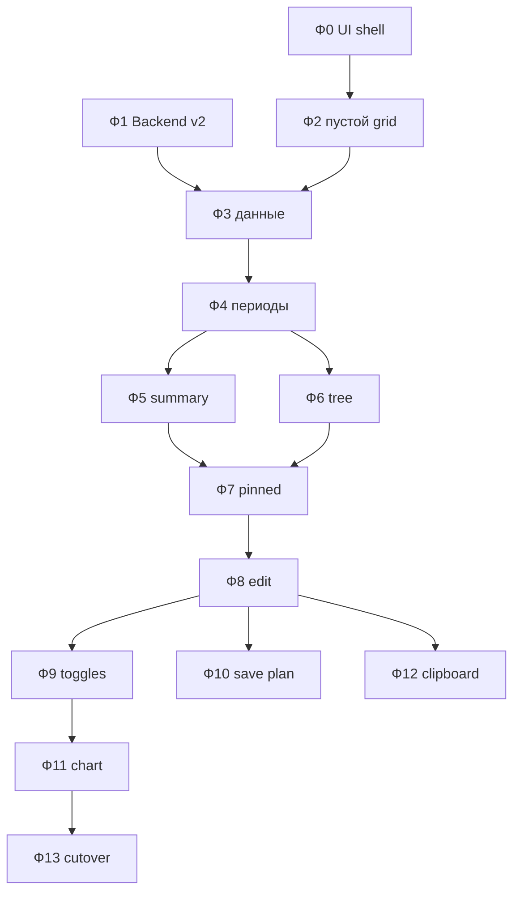

# P&L v2 — план реализации

> Ветка: `dinext_projects_pl` → `ISS-2026-00926-try3`  
> Подход: слои с нуля, dual-table, фичи по фазам. Образец: `try3/we/`.  
> **Актуализация 2026-07-15:** клиентский WIP удалён. Источник статуса — [`index.md`](index.md). Фазы ниже — дорожная карта rewrite, не «уже сделано».

---

## Фаза 0 — UI shell

**Цель:** пустой v2-контейнер под legacy, legacy не трогаем.

| Шаг | Действие |
|-----|----------|
| 0.1 | `dual-preview-mount.js` — `.budget-table-v2` после `.budget-table` |
| 0.2 | Бейдж «P&L v2 (preview)» |
| 0.3 | Флаг `frm._pl_v2_enabled` (default `true`) |
| 0.4 | `pl-v2.css` — section layout |
| 0.5 | Bridge + hooks: bundle + CSS |
| 0.6 | Вызов mount из `render_budget_table` (после legacy init) |

**Критерий:** Project → планирование: controls + legacy table + пустой v2 блок.

---

## Фаза 1 — Backend v2: контракты и чтение

| Шаг | Действие |
|-----|----------|
| 1.1 | `project_pl/v2/models.py` — TypedDict |
| 1.2 | `periods.py` — display periods |
| 1.3 | `grid_data.py` — flat scalar rows + merge + summary |
| 1.4 | API `get_pl_grid_v2` |
| 1.5 | Не ломать клиентский `load_budget_data` |

**Статус backend:** код на месте (см. index). Client rewrite **потребляет** этот API, не дублирует сборку на клиенте.

**Целевой контракт (черновик):**

```python
class PlV2Row(TypedDict, total=False):
    id: str
    account: str
    account_label: str
    parent_account: str | None
    dimensions: list  # fingerprint / labels
    merge_group_id: str
    merge_group_index: int
    merge_group_size: int
    has_children: bool
    # plan_2026_7, forecast_2026_7, fact_2026_7, delta_2026_7, ...
```

**Критерий:** API JSON; unit/parity позже с legacy numbers.

---

## Фаза 2 — Client v2: пустой DinextTable

| Шаг | Действие |
|-----|----------|
| 2.1 | `table.js` — `frappe.require(["dinext-table.bundle.js"])` + `DinextTable.create` |
| 2.2 | `columns.js` — stub: account |
| 2.3 | `state.js` — `frm.pl_v2` |
| 2.4 | destroy/recreate при refresh формы |

**Критерий:** пустой AG Grid в v2, без ошибок console.

---

## Фаза 3 — Данные и базовые колонки (read-only)

| Шаг | Действие |
|-----|----------|
| 3.1 | `data.js` — `get_pl_grid_v2` |
| 3.2 | Колонки: account (tree) |
| 3.3 | Merge на account при dimensions |
| 3.4 | Read-only |

---

## Фаза 4 — Периоды scalar

| Шаг | Действие |
|-----|----------|
| 4.1 | 3 sub-columns на период (plan / actual / delta) |
| 4.2 | Column groups по месяцам |
| 4.3 | Hide plan/delta по флагам |

---

## Фаза 5 — Summary

| Шаг | Действие |
|-----|----------|
| 5.1 | `summaryRows`: прибыль + рентабельность |
| 5.2 | Стили в `pl-v2.css` |

---

## Фаза 6 — Tree

| Шаг | Действие |
|-----|----------|
| 6.1 | Account tree eager |
| 6.2 | Persist `expandedIds` |

---

## Фаза 7 — Pinned + layout

Pinned left: account (+ serial/checkbox позже). Horizontal scroll периодов.

---

## Фаза 8 — Edit forecast

| Шаг | Действие |
|-----|----------|
| 8.1 | `edit` на forecast columns |
| 8.2 | `onSaveCells` → `pl_v2_save_forecast_changes` |
| 8.3 | Убрать jQuery path для v2 container |

---

## Фаза 9 — View options / toggles

Shared controls → обновлять v2 (и legacy на dual-period).

---

## Фаза 10 — Selection + Save plan

Только выбранный bucket (account + dimensions). Не писать rolled head totals в empty-dim.

---

## Фаза 11 — Chart / integrations

Chart читает `frm.pl_v2` или shared aggregate.

---

## Фаза 12 — Excel UX

Clipboard / fill из ядра.

---

## Фаза 13 — Cutover

Убрать legacy table init; оставить v2.

---

## Целевая структура файлов

```text
public/js/project_pl/v2/
  dual-preview-mount.js
  mount.js
  state.js
  table.js
  columns.js
  data.js
  save.js
  tree.js          # persist expand (паттерн WE summary/tree)
  selection.js     # save plan
  chart-adapter.js # optional
  index.js
  pl-v2.bundle.js

public/js/project_pl/v2-preview-bridge.js
public/css/pl-v2.css

dinext_projects_pl/project_pl/v2/   # УЖЕ ЕСТЬ — не удалять
  models.py
  periods.py
  grid_data.py
  amounts.py
  dimensions.py
  summary.py
  save.py
  api.py
```

---

## Зависимости


