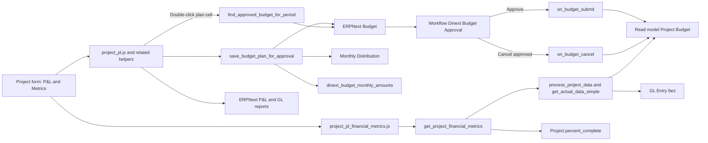

[Русский](README.ru.md)

# Dinext Projects P&L

## 📖 Overview

**Dinext Projects P&L** is a Frappe/ERPNext application that extends the standard `Project` DocType with project P&L, planning, forecasting, reporting and budget approval. Following the semantic separation, it owns financial master data (`Cost Level`, `Rate Category` / `Rate Table`, `Account Table`, `Cost Center Table`, `Business Area`, `Project Payment Scheme`, `Worker Level`), rate-control reports, the `Dinext_Financier` / `Dinext_Fin_Dir` / `Dinext_Budget_Approver` roles, the **Financial Control** and **Analytics** workspaces, and the **Commercial Projects** Number Card.

The application combines a custom P&L interface and a separate `Metrics` tab on the project form with Dinext budgeting logic. Current planned and forecast data is displayed and edited in the project UI, EVM metrics are calculated on the server through a single whitelisted API and displayed on the `Metrics` tab, and plan saving operates in two modes: through standard ERPNext `Budget` and `Monthly Distribution` documents with an approval workflow, or by writing directly to the custom `Project Budget` read model. Exact approved monthly amounts are stored separately from the percentage-based `Monthly Distribution`, preventing persisted plan values from drifting due to round-trip rounding.

## ✨ Features

- **Custom P&L tab in `Project`** with an effort/cost table, summary blocks, report buttons and a chart.
- **Separate `Metrics` tab in `Project`** with financial EVM metrics for revenue and expense domains, a reporting date and server-side calculation of `BAC/PV/EV/AC/CV/SV/CPI/SPI/EAC/ETC/VAC/TCPI`.
- **Single server-side EVM metrics API** `get_project_financial_metrics`, reusing plan/actual aggregation from the report pipeline and returning a ready-to-use UI payload.
- **Plan / forecast / actual views** with toggles for plan and delta visibility.
- **Budget approval flow** in which saving a plan from P&L creates an ERPNext `Budget`, rather than writing directly to `Project Budget`, when the site-level approval toggle is enabled.
- **Site-level plan-saving toggle**: switch between the approval workflow and directly saving `pba_plan` without `Budget` or a workflow.
- **Budget granularity by key**: one `Budget` per `account + project/task + fiscal year` combination.
- **Dinext approval workflow** with dedicated roles:
  - `Dinext_Project_Manager` submits for approval;
  - `Dinext_Budget_Approver` approves and cancels.
- **Replacement semantics**:
  - a new request cancels the existing pending budget for the same canonical key;
  - approving a new version cancels the previously approved budget for the same key.
- **Exact storage of approved monthly amounts** in the hidden `Budget.dinext_budget_monthly_amounts` field, while `Monthly Distribution` remains a derived ERPNext artifact.
- **`Project Budget` synchronization** on submit/cancel through app-owned Python hooks.
- **Navigation from the P&L table**:
  - double-clicking an account/task row opens the `Budget` list;
  - double-clicking a planned amount cell opens the corresponding approved `Budget`;
  - double-clicking an actual amount cell opens `General Ledger`.
- **Script Report** `Project Budget Plan vs Forecast` for comparing the plan with forecast and actuals.
- **Analytics workspace** (nested under My Projects) with financial number cards/charts and ERPNext report shortcuts; the **Commercial Projects** Number Card is supplied by this application.
- **Fixture-driven metadata delivery** for workflows, workflow states, actions, roles, accounting dimensions, custom fields, client scripts and related metadata.

## 🚀 Installation

Install the application into an existing bench:

```bash
cd $PATH_TO_YOUR_BENCH
bench get-app $URL_OF_THIS_REPO --branch develop
bench install-app dinext_projects_pl
```

Then apply schema and metadata changes:

```bash
bench --site $SITE migrate
```

The application relies on fixture-based and module JSON metadata delivery. Installation and migration apply custom fields, client/server scripts, accounting dimensions, the `Dinext Budget Approval` workflow, workflow states/actions, financial roles, Financial Control / Analytics workspaces, number cards/charts and rate-control reports.

`required_apps`: `dinext_common`, `doctype_permission`, `dinext_projects`.

## 🛠️ Usage

### Main P&L scenario

1. Open a `Project` document.
2. Go to the custom P&L section.
3. Review the plan, forecast and actuals by month.
4. Click `Save Plan`.
5. Client code calls the app-owned Python service `save_budget_plan_for_approval`, which groups rows by `account + target + fiscal year`, then:
   - **by default**, creates `Budget` and `Monthly Distribution`, stores the exact original monthly amounts in `Budget` metadata, and moves the budget into the Dinext approval workflow;
   - **if the site-level toggle is disabled**, immediately updates `Project Budget.pba_plan` without creating a `Budget` or using a workflow.

### Metrics viewing scenario

1. Open a `Project` document.
2. Go to the `Metrics` tab.
3. Select the `Metrics Reporting Date`.
4. Client code calls the server API `get_project_financial_metrics`, which:
   - collects the monthly plan from `Project Budget` through `process_project_data`;
   - collects actuals from `GL Entry` through `get_actual_data_simple`;
   - calculates EVM metrics as of the selected reporting date, prorating the current month.
5. Review EVM metrics for the two domains:
   - `Revenue`;
   - `Expenses`.
6. Use `BAC`, `PV`, `EV`, `AC`, `CV`, `SV`, `CPI`, `SPI`, `EAC`, `ETC`, `VAC`, `TCPI` to analyze project performance as of the selected date.

Example API call from code:

```python
frappe.call(
    "dinext_projects_pl.dinext_projects_pl.financial_metrics.service.get_project_financial_metrics",
    project="PROJ-0001",
    reporting_date="2026-01-15",
)
```

```javascript
frappe.call({
    method: "dinext_projects_pl.dinext_projects_pl.financial_metrics.service.get_project_financial_metrics",
    args: {
        project: frm.doc.name,
        reporting_date: frm._financial_metrics_reporting_date,
    },
});
```

### Budget approval

- Approval mode is controlled by the `dinext_projects_pl_enable_plan_approval` site config key.
- If the key is `1`, the approval flow through `Budget` is used.
- If the key is `0`, the plan is saved directly to `Project Budget`, and the approval workflow does not run.
- Pending budgets are in the `Pending Approval` state.
- On `Approve`, the budget is submitted and synchronized to `Project Budget`.
- When a replacement version is approved, the previously approved budget for the same canonical key is canceled, and the new version becomes the source of truth.
- When a previously approved budget is canceled, the read model is either restored from another approved replacement or cleared for the affected months.

### UI helpers

- Double-clicking an account/task row in P&L opens the matching `Budget` documents.
- Double-clicking a planned amount cell opens the approved `Budget` for that period.
- Report buttons open ERPNext financial reports filtered by project.

### Extending the forecast menu

Other applications can extend the `Add Forecast` dropdown through a global registry:

```javascript
frappe.provide("dinext_projects.project_budget_forecast_menu");
dinext_projects.project_budget_forecast_menu =
  dinext_projects.project_budget_forecast_menu || [];
dinext_projects.project_budget_forecast_menu.push({
  label: __("My Forecast"),
  action(frm) {
    // custom logic
  },
});
```

If items are added after the initial render, call
`dinext_projects.refresh_project_budget_forecast_dropdown(frm)`.

For cutover from the old risk module, the aliases `project_pl_forecast_menu` and
`refresh_pl_forecast_dropdown` are available (the same array / the same function).

## 📦 Technologies

- **Python 3.10+**
- **Frappe Framework**
- **ERPNext** (`Budget`, `Monthly Distribution`, financial reports)
- **JavaScript client scripts** for `Project`
- **Fixture-driven metadata** through `hooks.py`
- **Ruff**, **ESLint**, **Prettier** and **pre-commit** for local development

## 🔧 Configuration

The application introduces no environment variables of its own. Main configuration uses Frappe metadata, `site_config.json` and standard ERPNext entities:

- `site_config.json`:
  - `dinext_projects_pl_enable_plan_approval` — enables (`1`) or disables (`0`, default) plan saving through the `Budget` workflow.
- Configuration example:

```bash
bench --site $SITE set-config dinext_projects_pl_enable_plan_approval 0
```

When the key is disabled, the `Save Plan` button continues to use the same server API, but it writes values directly to `Project Budget.pba_plan` without creating `Budget` / `Monthly Distribution`.

- fixtures for `Accounting Dimension`;
- custom fields in `Budget`:
  - `dinext_budget_account`;
  - `dinext_budget_monthly_amounts`;
  - `workflow_state`;
- workflow metadata for `Dinext Budget Approval`;
- custom fields and client scripts for the project UI, including the `P&L` and `Metrics` tabs.

Important operational details:

- `Monthly Distribution` is a derived artifact for ERPNext monthly checks, rather than the source of truth for approved plan synchronization.
- Exact approved monthly amounts are stored directly in `Budget` to prevent drift from round-trip rounding.
- With `dinext_projects_pl_enable_plan_approval = 0`, `Project Budget.pba_plan` immediately becomes the source of truth for new `Save Plan` operations, without an intermediate `Budget`.
- `Project Budget.pba_expected` remains an independent forecast and is not automatically overwritten during approval synchronization.
- EVM metrics use only `pba_plan` and actuals from `GL Entry`; the forecast (`pba_expected`) is excluded from EVM calculations.
- The EVM reporting date is passed explicitly to the API; current-month proration is performed on the server.
- The `server_script.json` fixture is still present in the repository, but the primary plan approval path is implemented in an app-owned Python service rather than a site-only server script.

## ✅ Requirements

- A working **bench** with **Frappe**.
- **ERPNext** installed on the target site for standard budget/report DocTypes and their logic.
- **Python >= 3.10** according to [pyproject.toml](pyproject.toml).
- Access to the standard financial DocTypes and reports used by the application.

## 🤝 Contributing

Enable local checks through `pre-commit`:

```bash
cd apps/dinext_projects_pl
pre-commit install
```

Main development tools:

- `ruff` for Python linting, formatting and import ordering;
- `eslint` for JavaScript;
- `prettier` for frontend formatting;
- `pyupgrade` for Python syntax upgrades.

If metadata needs to change:

1. Make the changes through the Frappe/ERPNext system.
2. Then run:

```bash
bench --site $SITE export-fixtures --app dinext_projects_pl
```

Do not manually edit generated fixture JSON files.

Running regression tests:

```bash
bench --site $SITE run-tests --app dinext_projects_pl
node --test tests/js/project_pl_financial_metrics.test.js
node --test tests/js/project_pl_echarts.test.js
```

## 📄 Documentation

- [README.md](README.md) — repository and current architecture overview.
- [dinext_projects_pl/hooks.py](dinext_projects_pl/hooks.py) — application wiring, fixture filters and hooks.
- [dinext_projects_pl/dinext_projects_pl/budget_approval/service.py](dinext_projects_pl/dinext_projects_pl/budget_approval/service.py) — budget approval services and synchronization logic.
- [dinext_projects_pl/dinext_projects_pl/financial_metrics/service.py](dinext_projects_pl/dinext_projects_pl/financial_metrics/service.py) — whitelisted API for project EVM metric calculation.
- [dinext_projects_pl/dinext_projects_pl/financial_metrics/data.py](dinext_projects_pl/dinext_projects_pl/financial_metrics/data.py) — server-side monthly plan/actual aggregation for EVM.
- [dinext_projects_pl/dinext_projects_pl/financial_metrics/calculations.py](dinext_projects_pl/dinext_projects_pl/financial_metrics/calculations.py) — EVM formulas and response payload construction.
- [dinext_projects_pl/public/js/project_pl_financial_metrics.js](dinext_projects_pl/public/js/project_pl_financial_metrics.js) — client rendering layer for the `Metrics` tab.
- [dinext_projects_pl/dinext_projects_pl/budget_approval/bootstrap.py](dinext_projects_pl/dinext_projects_pl/budget_approval/bootstrap.py) — workflow, role and field constants.
- [dinext_projects_pl/dinext_projects_pl/overrides/budget.py](dinext_projects_pl/dinext_projects_pl/overrides/budget.py) — duplicate validation override for `Budget`.
- [dinext_projects_pl/dinext_projects_pl/doctype/project_budget/test_project_budget.py](dinext_projects_pl/dinext_projects_pl/doctype/project_budget/test_project_budget.py) — budget approval flow regression tests.
- [dinext_projects_pl/tests/test_financial_metrics_service.py](dinext_projects_pl/tests/test_financial_metrics_service.py) — unit/integration tests for server-side EVM metric calculation.
- [tests/js/project_pl_financial_metrics.test.js](tests/js/project_pl_financial_metrics.test.js) — `Metrics` tab rendering layer JS tests.
- [tests/js/project_pl_echarts.test.js](tests/js/project_pl_echarts.test.js) — P&L ECharts JS tests (palette, tooltip, markLine, toolbox, geometry).

## 🗂️ Repository structure

```text
.
├── README.md
├── license.txt
├── pyproject.toml
├── .pre-commit-config.yaml
├── .eslintrc
├── .editorconfig
└── dinext_projects_pl/
    ├── __init__.py
    ├── hooks.py
    ├── modules.txt
    ├── patches.txt
    ├── fixtures/
    │   ├── accounting_dimension.json
    │   ├── client_script.json
    │   ├── custom_field.json
    │   ├── role.json
    │   ├── server_script.json
    │   ├── workflow.json
    │   ├── workflow_action_master.json
    │   └── workflow_state.json
    ├── public/
    │   ├── css/
    │   │   └── project_budget.css
    │   └── js/
    │       ├── project_budget/          # DinextTable module (ProjectBudget)
    │       ├── project_budget_tab.js
    │       ├── project_budget_navigation.js
    │       ├── project_budget_chart.js
    │       ├── project_budget_dashboard.js
    │       └── project_budget_metrics.js
    ├── tests/
    │   └── js/
    │       ├── project_pl_financial_metrics.test.js
    │       └── project_pl_echarts.test.js
    └── dinext_projects_pl/
        ├── budget_approval/
        │   ├── __init__.py
        │   ├── bootstrap.py
        │   └── service.py
        ├── financial_metrics/
        │   ├── __init__.py
        │   ├── constants.py
        │   ├── calculations.py
        │   ├── data.py
        │   └── service.py
        ├── overrides/
        │   ├── __init__.py
        │   └── budget.py
        ├── doctype/
        │   ├── project_budget/
        │   ├── project_budget_amount/
        │   └── project_budget_dimension/
        ├── report/
        │   └── project_budget_plan_vs_forecast/
        ├── workspace/
        │   ├── аналитика/
        │   └── фин._контроль/
        ├── number_card/
        │   ├── выручка/
        │   ├── расходы/
        │   └── коммерческие_проекты/
        ├── dashboard_chart/
        └── tests/
            ├── test_app_bootstrap.py
            └── test_financial_metrics_service.py
```

- `dinext_projects_pl/hooks.py` connects client assets, fixtures, the `Budget` override and submit/cancel hooks.
- `dinext_projects_pl/fixtures/` contains system-generated metadata exported from the site.
- `dinext_projects_pl/dinext_projects_pl/workspace/` contains the Financial Control and Analytics Desk Workspaces (module JSON).
- `dinext_projects_pl/dinext_projects_pl/number_card/` and `dashboard_chart/` contain financial KPIs and charts; the Commercial Projects Number Card also belongs to this module.
- `dinext_projects_pl/public/js/` contains the project UI, data aggregation, P&L chart rendering, the `P&L`/`Metrics` tabs and interactive navigation handlers.
- `dinext_projects_pl/public/js/project_pl_financial_metrics.js` provides thin client rendering for the `Metrics` tab; calculation is performed on the server.
- `dinext_projects_pl/dinext_projects_pl/budget_approval/` contains the app-owned budget approval flow and synchronization with `Project Budget`.
- `dinext_projects_pl/dinext_projects_pl/financial_metrics/` contains server-side EVM metric calculation and a whitelisted API for the project UI.
- `dinext_projects_pl/dinext_projects_pl/overrides/` adapts ERPNext `Budget` duplicate checks to Dinext replacement semantics.
- `dinext_projects_pl/dinext_projects_pl/doctype/` defines the custom `Project Budget` read model.
- `dinext_projects_pl/dinext_projects_pl/report/` contains the script report for plan/forecast comparison; its helpers are reused by the EVM API.
- `dinext_projects_pl/dinext_projects_pl/tests/` and `tests/js/` contain Python/JS regression tests for budget approval and EVM metrics.

## 🔗 Flow diagram



## 📝 Changelog

Recent significant repository-level changes:

- EVM metric calculation moved into the single server API `get_project_financial_metrics`; the client `Metrics` tab became a thin rendering layer;
- added Python/JS regression tests for server-side EVM calculation and the `Metrics` tab rendering layer;
- the main plan-saving flow moved from direct `Project Budget` writes to app-owned budget approval services;
- added Dinext workflow fixtures for `Budget` approval, including a dedicated approver role and workflow states/actions;
- added exact storage of approved monthly amounts in `Budget` to prevent round-trip drift during approval synchronization;
- added regression coverage for multi-month approval synchronization and replacement semantics.
