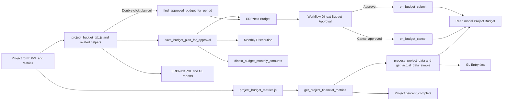
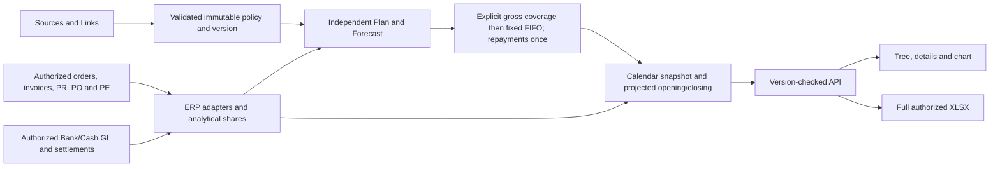

[Русский](README.ru.md)

<!-- dinext-presentation:start -->
<p align="center">
  <a href="https://dinext.ru"></a>
</p>
<h1 align="center">Dinext Projects P&amp;L</h1>

<hr>

<p align="center">Plan and control project revenue, costs, budgets and cash flows with project P&amp;L and the payment calendar.</p>

<p align="center">
  
</p>
<p align="center"><sub>Project P&amp;L, financial forecast and budget figures for a demonstration project.</sub></p>

<p align="center">
  <a href="https://dinext.ru">Website</a> · <a href="https://docs.dinext.ru">Documentation</a>
</p>
<!-- dinext-presentation:end -->

# Dinext Projects P&L

## 📖 Overview

**Dinext Projects P&L** is a Frappe/ERPNext application that extends the standard `Project` DocType with project P&L, planning, forecasting, reporting and budget approval. Following the semantic separation, it owns financial master data (`Cost Level`, `Rate Category` / `Rate Table`, `Account Table`, `Cost Center Table`, `Business Area`, `Project Payment Scheme`, `Worker Level`), rate-control reports, the `Dinext_Financier` / `Dinext_Fin_Dir` / `Dinext_Budget_Approver` roles, the **Financial Control** and **Analytics** workspaces, and the **Commercial Projects** Number Card.

The application combines a custom P&L interface and a separate `Metrics` tab on the project form with Dinext budgeting logic. Current planned and forecast data is displayed and edited in the project UI, EVM metrics are calculated on the server through a single whitelisted API and displayed on the `Metrics` tab, and plan saving operates in two modes: through standard ERPNext `Budget` and `Monthly Distribution` documents with an approval workflow, or by writing directly to the custom `Project Budget` read model. Exact approved monthly amounts are stored separately from the percentage-based `Monthly Distribution`, preventing persisted plan values from drifting due to round-trip rounding.

The payment calendar adds a company-scoped view of cash, independent plan/forecast, projected balances and source drill-down. Sources and refinement links are configurable; standalone requests are covered by fixed FIFO without modifying financial documents.

## ✨ Features

- **Liquidity Payment Calendar** with configurable Sources/Links, fixed FIFO, settings-aware projected opening/closing balances, a cash chart, permission-aware drill-down and full XLSX export.
- **Custom P&L tab in `Project`** with an effort/cost table, summary blocks, report buttons and a chart.
- **Separate `Metrics` tab in `Project`** with financial EVM metrics for revenue and expense domains, a reporting date and server-side calculation of `BAC/PV/EV/AC/CV/SV/CPI/SPI/EAC/ETC/VAC/TCPI`.
- **Single server-side EVM metrics API** `get_project_financial_metrics`, reusing plan/actual aggregation from the report pipeline and returning a ready-to-use UI payload.
- **Plan / forecast / actual views** with toggles for plan and delta visibility.
- **Budget approval flow** in which saving a plan from P&L creates an ERPNext `Budget`, rather than writing directly to `Project Budget`, when the site-level approval toggle is enabled.
- **Site-level plan-saving toggle**: switch between the approval workflow and directly saving `pba_plan` without `Budget` or a workflow.
- **Budget granularity by key**: one `Budget` per `account + project/task + fiscal year` combination.
- **Dinext approval workflow** with dedicated roles:
  - `Dinext_Project_Manager` submits for approval;
  - `Dinext_Budget_Approver` approves and cancels.
- **Replacement semantics**:
  - a new request cancels the existing pending budget for the same canonical key;
  - approving a new version cancels the previously approved budget for the same key.
- **Exact storage of approved monthly amounts** in the hidden `Budget.dinext_budget_monthly_amounts` field, while `Monthly Distribution` remains a derived ERPNext artifact.
- **`Project Budget` synchronization** on submit/cancel through app-owned Python hooks.
- **Navigation from the P&L table**:
  - double-clicking an account/task row opens the `Budget` list;
  - double-clicking a planned amount cell opens the corresponding approved `Budget`;
  - double-clicking an actual amount cell opens `General Ledger`.
- **Script Report** `Project Budget Plan vs Forecast` for comparing the plan with forecast and actuals.
- **Analytics workspace** (nested under My Projects) with financial number cards/charts and ERPNext report shortcuts; the **Commercial Projects** Number Card is supplied by this application.
- **Fixture-driven metadata delivery** for workflows, workflow states, actions, roles, accounting dimensions, custom fields, client scripts and related metadata.

## 🚀 Installation

Install the application into an existing bench:

```bash
cd $PATH_TO_YOUR_BENCH
bench get-app https://github.com/Dinext-pro/dinext-projects-pl --branch develop
bench --site "$SITE" install-app dinext_projects_pl
```

Then apply schema and metadata changes:

```bash
bench --site "$SITE" migrate
bench build --app dinext_projects_pl
bench --site "$SITE" clear-cache
```

The application relies on fixture-based and module JSON metadata delivery. Installation and migration apply custom fields, client/server scripts, accounting dimensions, the `Dinext Budget Approval` workflow, workflow states/actions, financial roles, Financial Control / Analytics workspaces, number cards/charts and rate-control reports.

`required_apps`: `dinext_common`, `doctype_permission`, `dinext_projects`.

These commands target a development site; select its existing site name in `SITE`. For an existing checkout, update the reviewed ref and run migrate/build/clear-cache; this is not a production deployment instruction. Repeated migrations preserve saved calendar settings and create the GL/PLE query indexes idempotently. Refresh Desk after asset changes.

## 🛠️ Usage

### Payment calendar

Open **Liquidity Payment Calendar** from **Analytics**, **Financial Control** or the Desk report search. Its route is `/app/query-report/Liquidity%20Payment%20Calendar`.

1. Select a company, date range and day/week/month grain. Narrow the view by project, portfolio, counterparty type/name or Bank/Cash account.
2. Choose project-first, counterparty-first or **Only Counterparty** grouping. Contract, order, invoice and payment levels remain available below the selected grouping.
3. Use **Forecast / actual**, **Only actual** or **Only forecast**; **Plan** is an independent toggle. In the combined view, completed periods show actuals and the current/future periods show forecast, without adding the two stages together.
4. Expand levels in batches, select amounts to see selection statistics, double-click an amount for source details or double-click a linked name to open its document.
5. Compare balances and the cash chart; use the XLSX button immediately left of the table's Fullscreen control. Detail headers stay visible while scrolling. Both Desk themes are supported, including a runtime theme switch.

The calendar is read-only. It recalculates from authorized source documents without changing them or storing a separate allocation register. Actual cash and actual opening balances come from authorized Bank/Cash `GL Entry` movements. Plan and forecast are calculated independently using **Payment Calendar Settings**. Projected balances, including the projected opening balance before the displayed range, include the same settings-derived expected movements; incomplete or restricted company-wide cash coverage hides company balances instead of presenting a partial balance as complete.

Standalone Payment Requests are covered by invoices using fixed FIFO after explicit links. Matching requires the same company, direction, party type/name, project, contract and original currency; blank analytics match blank analytics. A common order is optional, while conflicting order links prevent a match. Invoices may predate a request. Coverage uses full obligations and retains paid/out-of-range documents; repayments are deducted after allocation exactly once. For request `100`, invoice `60` and invoice payment `20`, forecast is `40` uncovered request + `40` invoice debt = **80**. FIFO queue order uses request `transaction_date` / invoice `posting_date`, then `creation` and `name`, with missing dates last; changing expected date fields does not change this fixed queue order.

Payment Orders and draft Payment Entries refine the covered amount/date according to the configured links and priorities. Currency conversion keeps expected cash valuation separate from the obligation's book value; a later instruction cannot consume the same obligation twice. Submitted payments remain accounting/settlement evidence even when excluded from expected sources.

XLSX uses the full authorized tree regardless of expanded rows. It contains Calendar, Components, Parameters and Allocations sheets, plus Balances when available. Parameters include the settings snapshot/version and FIFO algorithm identity; allocation evidence contains authorized explicit/FIFO coverage. Monetary cells stay numeric with their calculation precision, and formula-like text is escaped.

#### Payment calendar API

Methods use the prefix `dinext_projects_pl.liquidity.api.`; filter and response contracts are in [liquidity/contracts.py](dinext_projects_pl/liquidity/contracts.py) and [liquidity/model.py](dinext_projects_pl/liquidity/model.py).

| Method | Contract |
| --- | --- |
| `get_calendar` | Authorized initial snapshot; returns `settings_version` with rows, periods, KPIs, warnings and available balances. |
| `get_children` | Returns `{rows, settings_version}` for a node; pass the initial `expected_settings_version`. |
| `get_cell_details` | Bounded, authorized components for a cell; pass the same expected version. |
| `export_liquidity_calendar` | Downloads the workbook for the full permitted scope; pass the same expected version. |
| `get_options` | Permission-aware company, project, portfolio, account and counterparty suggestions. |
| `get_settings_catalog` | Supported source date/status choices; available only to authorized configuration managers. |

For browser follow-ups, a missing or stale `expected_settings_version` returns HTTP `409` with `error: "calendar_settings_changed"`. Refresh the calendar and retry with the new version; do not combine stale rows with the new settings. Other errors retain normal Frappe reporting.

### Main P&L scenario

1. Open a `Project` document.
2. Go to the custom P&L section.
3. Review the plan, forecast and actuals by month.
4. Click `Save Plan`.
5. Client code calls the app-owned Python service `save_budget_plan_for_approval`, which groups rows by `account + target + fiscal year`, then:
   - **when approval is enabled**, creates `Budget` and `Monthly Distribution`, stores the exact original monthly amounts in `Budget` metadata, and moves the budget into the Dinext approval workflow;
   - **if the site-level toggle is disabled**, immediately updates `Project Budget.pba_plan` without creating a `Budget` or using a workflow.

### Metrics viewing scenario

1. Open a `Project` document.
2. Go to the `Metrics` tab.
3. Select the `Metrics Reporting Date`.
4. Client code calls the server API `get_project_financial_metrics`, which:
   - collects the monthly plan from `Project Budget` through `process_project_data`;
   - collects actuals from `GL Entry` through `get_actual_data_simple`;
   - calculates EVM metrics as of the selected reporting date, prorating the current month.
5. Review EVM metrics for the two domains:
   - `Revenue`;
   - `Expenses`.
6. Use `BAC`, `PV`, `EV`, `AC`, `CV`, `SV`, `CPI`, `SPI`, `EAC`, `ETC`, `VAC`, `TCPI` to analyze project performance as of the selected date.

Example API call from code:

```python
frappe.call(
    "dinext_projects_pl.dinext_projects_pl.financial_metrics.service.get_project_financial_metrics",
    project="PROJ-0001",
    reporting_date="2026-01-15",
)
```

```javascript
frappe.call({
    method: "dinext_projects_pl.dinext_projects_pl.financial_metrics.service.get_project_financial_metrics",
    args: {
        project: frm.doc.name,
        reporting_date: frm._financial_metrics_reporting_date,
    },
});
```

### Budget approval

- Approval mode is controlled by the `dinext_projects_pl_enable_plan_approval` site config key.
- If the key is `1`, the approval flow through `Budget` is used.
- If the key is `0`, the plan is saved directly to `Project Budget`, and the approval workflow does not run.
- Pending budgets are in the `Pending Approval` state.
- On `Approve`, the budget is submitted and synchronized to `Project Budget`.
- When a replacement version is approved, the previously approved budget for the same canonical key is canceled, and the new version becomes the source of truth.
- When a previously approved budget is canceled, the read model is either restored from another approved replacement or cleared for the affected months.

### UI helpers

- Double-clicking an account/task row in P&L opens the matching `Budget` documents.
- Double-clicking a planned amount cell opens the approved `Budget` for that period.
- Report buttons open ERPNext financial reports filtered by project.

### Extending the forecast menu

Other applications can extend the `Add Forecast` dropdown through a global registry:

```javascript
frappe.provide("dinext_projects.project_budget_forecast_menu");
dinext_projects.project_budget_forecast_menu =
  dinext_projects.project_budget_forecast_menu || [];
dinext_projects.project_budget_forecast_menu.push({
  label: __("My Forecast"),
  action(frm) {
    // custom logic
  },
});
```

If items are added after the initial render, call
`dinext_projects.refresh_project_budget_forecast_dropdown(frm)`.

For cutover from the old risk module, the aliases `project_pl_forecast_menu` and
`refresh_pl_forecast_dropdown` are available (the same array / the same function).

## 📦 Technologies

- **Python 3.10+**
- **Frappe Framework 15**
- **ERPNext 15** (`Budget`, `Monthly Distribution`, financial reports)
- **AG Grid / DinextTable and ECharts** from `dinext_common`, loaded within the active report
- **JavaScript client scripts** for `Project`
- **Fixture-driven metadata** through `hooks.py`
- **Ruff**, **ESLint**, **Prettier** and **pre-commit** for local development

## 🔧 Configuration

The application introduces no environment variables of its own. Main configuration uses Frappe metadata, `site_config.json` and standard ERPNext entities:

- `site_config.json`:
  - `dinext_projects_pl_enable_plan_approval` — enables (`1`) or disables (`0`, default) plan saving through the `Budget` workflow.
- Configuration example:

```bash
bench --site $SITE set-config dinext_projects_pl_enable_plan_approval 0
```

When the key is disabled, the `Save Plan` button continues to use the same server API, but it writes values directly to `Project Budget.pba_plan` without creating `Budget` / `Monthly Distribution`.

- fixtures for `Accounting Dimension`;
- custom fields in `Budget`:
  - `dinext_budget_account`;
  - `dinext_budget_monthly_amounts`;
  - `workflow_state`;
- workflow metadata for `Dinext Budget Approval`;
- custom fields and client scripts for the project UI, including the `P&L` and `Metrics` tabs.

Important operational details:

- `Monthly Distribution` is a derived artifact for ERPNext monthly checks, rather than the source of truth for approved plan synchronization.
- Exact approved monthly amounts are stored directly in `Budget` to prevent drift from round-trip rounding.
- With `dinext_projects_pl_enable_plan_approval = 0`, `Project Budget.pba_plan` immediately becomes the source of truth for new `Save Plan` operations, without an intermediate `Budget`.
- `Project Budget.pba_expected` remains an independent forecast and is not automatically overwritten during approval synchronization.
- EVM metrics use only `pba_plan` and actuals from `GL Entry`; the forecast (`pba_expected`) is excluded from EVM calculations.
- The EVM reporting date is passed explicitly to the API; current-month proration is performed on the server.
- The `server_script.json` fixture is still present in the repository, but the primary plan approval path is implemented in an app-owned Python service rather than a site-only server script.

### Payment Calendar Settings

Open the **Payment Calendar Settings** Single from Desk search. Its only business sections are **Sources** and **Links**. Standard write permission and a **System Manager** or **Accounts Manager** role are required to configure it. Ordinary report users do not need direct access to this form; their company, project and source-document permissions still apply.

**Sources** has an independent row for each metric/DocType combination. It controls participation in Plan, Forecast or both; enabled state; priority; Draft/Submitted/Both document state; allowed business states; expected date field and fallback. Date choices come from installed Date/Datetime metadata and supported payment schedules. Empty business-state selection accepts all states allowed by the document-state rule; canceled documents are always excluded.

An omitted source row does not participate in that metric; any enabled link must reference configured source rows.

**Links** sets directed refinement relationships separately for Plan and Forecast. Links follow strictly increasing priorities; duplicate sources/links, unsupported fields/states and cycles are rejected. An unmatched amount remains an independent expected amount. There are **no FIFO parameters** in Settings: matching fields, gross coverage, queue dates/order and explicit-link precedence remain fixed in code.

Initial profile (fourteen source rows, seven per metric; thirty-eight forward links):

| Source | Initially enabled for | Document state | Expected date / fallback |
| --- | --- | --- | --- |
| `Sales Order`, `Purchase Order` | Plan | Submitted | `payment_schedule` / `undated` |
| `Sales Invoice`, `Purchase Invoice` | Forecast | Submitted | `payment_schedule` / `due_date` |
| `Payment Request` | Forecast | Submitted; initial allowed business states exclude Draft, Cancelled and Failed | `transaction_date` / `previous` |
| `Payment Order` | Forecast | Submitted | `posting_date` / `previous` |
| `Payment Entry` | Forecast | **Draft only** | `posting_date` / `previous` |

Migration seeds this profile only if both Sources and Links are empty; existing saved profiles, including intentionally disabled sources, are preserved. An invalid/empty saved profile produces a diagnostic rather than silent runtime defaults. Every calculation loads one immutable policy and content version; table, details, chart, projected opening/closing balances and XLSX use that policy. Source switches do not alter actual GL cash or actual opening balances.

### Calendar limits and verification

The scope is one company per calculation. Monetary values are calculated in company currency, with original-currency and analytical provenance in details. Missing source permissions or ambiguous allocations produce warnings and may suppress company balances; narrowing a view is not permission to disclose hidden shares.

The complete 10,000-source benchmark uses 2,000 chains, 4,000 Payment Order rows, two projects/counterparties, real GL/PLE rows and an ordinary financier. After warm-up it checks five summary requests against `5 s` and five detail requests against `2 s`, with completeness, amounts and query counts asserted. The hosted acceptance environment passed these thresholds; local detail timings have exceeded `2 s`. Performance evidence is environment-specific, not a guarantee for every machine. No financial snapshot is cached between requests.

## ✅ Requirements

- A development bench with **Frappe 15 / ERPNext 15**, MariaDB and Redis, and the three required Dinext apps installed on the site. Framework runtime prerequisites are managed by bench; the acceptance workflow pins its dependency revisions.
- **Node.js** and **Yarn** for the asset/test chain; the hosted acceptance workflow uses Node 20 and Python 3.11.
- **openpyxl** in the bench environment for XLSX (provided by the ERPNext environment).
- **ERPNext** installed on the target site for standard budget/report DocTypes and their logic.
- **Python >= 3.10** according to [pyproject.toml](pyproject.toml).
- Access to the standard financial DocTypes and reports used by the application.

## 🤝 Contributing

Follow [AGENTS.md](AGENTS.md) and the central Dinext OpenSpec/development guidance before changing the app. Maintain English/Russian README parity in the same PR. Propose source changes from a feature branch into `develop`; merge, release and production deployment are separate decisions.

Enable local checks through `pre-commit`:

```bash
cd apps/dinext_projects_pl
pre-commit install
```

Main development tools:

- `ruff` for Python linting, formatting and import ordering;
- `eslint` for JavaScript;
- `prettier` for frontend formatting;
- `pyupgrade` for Python syntax upgrades.

If metadata needs to change:

1. Read current system metadata through MCP first. Change app-owned fields on their standard DocType, and use Custom Field/Property Setter only for external DocTypes. Record any required MCP-unavailable fallback and verify it by migrate/save/reload.
2. Then run:

```bash
bench --site $SITE export-fixtures --app dinext_projects_pl
```

Do not manually edit generated fixture JSON files.

Running regression tests:

```bash
bench --site $SITE run-tests --app dinext_projects_pl
node --test tests/js/project_pl_financial_metrics.test.js
node --test tests/js/project_pl_echarts.test.js
```

### Calendar tests and isolated acceptance

Server tests cover calculations, FIFO, currencies, settings save/reload, permissions and denied paths, initial balances, version conflicts and XLSX. Cypress covers the report and Settings, both themes/runtime switching, XLSX downloads, report-to-report navigation and the P&L lazy-mount regression. Use an isolated development site with tests enabled, installed dependencies and `DEV_SERVER=1` for test-only browser helpers. The runner resolves Cypress from Frappe; no Cypress Cloud key or `--parallel` is needed.

```bash
# From the bench root, with the intended development site selected:
bench --site "$SITE" run-tests --app dinext_projects_pl
bench --site "$SITE" run-tests --doctype "Payment Calendar Settings"

# From apps/dinext_projects_pl:
node --test tests/js/*.test.js tests/js/*.test.mjs

# From the bench root, while DEV_SERVER=1 is serving the same isolated site:
bench --site "$SITE" run-ui-tests dinext_projects_pl --headless --browser electron

# After browser fixtures have been cleaned up; CLI only:
bench --site "$SITE" execute dinext_projects_pl.tests.liquidity_ui_helpers.bootstrap
bench --site "$SITE" execute dinext_projects_pl.tests.liquidity_benchmark.run \
  --kwargs '{"chains": 2000, "repetitions": 5}'
bench --site "$SITE" execute dinext_projects_pl.tests.liquidity_ui_helpers.cleanup
```

Run these site operations sequentially. The benchmark rolls back its financial dataset and writes measurements/environment/code fingerprint to `/tmp/liquidity-benchmark.json`; bootstrap/cleanup own synthetic test users and settings and must not be run against production. Always run cleanup after a failure. The application itself adds no production secrets or deployment action.

[Dinext acceptance](.github/workflows/dinext-acceptance.yml) provisions an ephemeral bench, runs the full server suite, requires all 63 browser cases with no skipped/failed cases, then enforces all ten 10k measurements. It uploads JUnit, screenshots and benchmark metadata. Standard validation and trusted Dinext policy remain separate required checks; do not replace them with a manual success.

## 📄 Documentation

- [liquidity/](dinext_projects_pl/liquidity/api.py) — typed calendar API, permission-aware ERP adapters, independent calculations and fixed FIFO.
- [Payment Calendar Settings](dinext_projects_pl/dinext_projects_pl/doctype/payment_calendar_settings/payment_calendar_settings.json) — standard Single, source/link child tables and settings tests.
- [Liquidity Payment Calendar](dinext_projects_pl/dinext_projects_pl/report/liquidity_payment_calendar/liquidity_payment_calendar.js) — report metadata, server fallback and scoped Desk view.
- [Calendar integration tests](dinext_projects_pl/tests/test_liquidity_integration.py), [Cypress scenarios](cypress/integration/liquidity_payment_calendar.js) and [benchmark](dinext_projects_pl/tests/liquidity_benchmark.py) — repeatable acceptance.


- [README.md](README.md) — repository and current architecture overview.
- [dinext_projects_pl/hooks.py](dinext_projects_pl/hooks.py) — application wiring, fixture filters and hooks.
- [dinext_projects_pl/dinext_projects_pl/budget_approval/service.py](dinext_projects_pl/dinext_projects_pl/budget_approval/service.py) — budget approval services and synchronization logic.
- [dinext_projects_pl/dinext_projects_pl/financial_metrics/service.py](dinext_projects_pl/dinext_projects_pl/financial_metrics/service.py) — whitelisted API for project EVM metric calculation.
- [dinext_projects_pl/dinext_projects_pl/financial_metrics/data.py](dinext_projects_pl/dinext_projects_pl/financial_metrics/data.py) — server-side monthly plan/actual aggregation for EVM.
- [dinext_projects_pl/dinext_projects_pl/financial_metrics/calculations.py](dinext_projects_pl/dinext_projects_pl/financial_metrics/calculations.py) — EVM formulas and response payload construction.
- [dinext_projects_pl/public/js/project_budget_metrics.js](dinext_projects_pl/public/js/project_budget_metrics.js) — client rendering layer for the `Metrics` tab.
- [dinext_projects_pl/dinext_projects_pl/budget_approval/bootstrap.py](dinext_projects_pl/dinext_projects_pl/budget_approval/bootstrap.py) — workflow, role and field constants.
- [dinext_projects_pl/dinext_projects_pl/overrides/budget.py](dinext_projects_pl/dinext_projects_pl/overrides/budget.py) — duplicate validation override for `Budget`.
- [dinext_projects_pl/tests/test_project_budget.py](dinext_projects_pl/tests/test_project_budget.py) — budget approval flow regression tests.
- [dinext_projects_pl/tests/test_financial_metrics_service.py](dinext_projects_pl/tests/test_financial_metrics_service.py) — unit/integration tests for server-side EVM metric calculation.
- [tests/js/project_pl_financial_metrics.test.js](tests/js/project_pl_financial_metrics.test.js) — `Metrics` tab rendering layer JS tests.
- [tests/js/project_pl_echarts.test.js](tests/js/project_pl_echarts.test.js) — P&L ECharts JS tests (palette, tooltip, markLine, toolbox, geometry).

## 🗂️ Repository structure

<details>
<summary>Full tracked repository tree (generated from this checkout)</summary>

```text
.
├── .cursor/
│   ├── commands/
│   │   ├── opsx-apply.md
│   │   ├── opsx-archive.md
│   │   ├── opsx-explore.md
│   │   ├── opsx-propose.md
│   │   ├── opsx-sync.md
│   │   └── opsx-update.md
│   └── rules/
│       └── dinext-central-first.mdc
├── .github/
│   ├── ci/
│   │   └── liquidity_ui.py
│   ├── imported-workflows-disabled/
│   │   └── linters.yml
│   ├── workflows/
│   │   ├── dinext-acceptance.yml
│   │   ├── dinext-policy.yml
│   │   └── dinext-validation.yml
│   ├── CI.md
│   ├── HISTORY-CLEANUP.md
│   └── dinext-ci.json
├── .issues/
│   └── ISS-2026-00926/
│       └── try3/
│           └── pl/
│               ├── decisions.md
│               ├── implementation-plan.md
│               ├── index.md
│               ├── legacy-cutover.md
│               ├── legacy-inventory.md
│               └── obsolete-cleanup.md
├── cypress/
│   ├── integration/
│   │   └── liquidity_payment_calendar.js
│   └── support/
│       ├── commands.js
│       └── e2e.js
├── dinext_projects_pl/
│   ├── config/
│   │   └── __init__.py
│   ├── dinext_projects_pl/
│   │   ├── budget_approval/
│   │   │   ├── __init__.py
│   │   │   ├── bootstrap.py
│   │   │   └── service.py
│   │   ├── dashboard_chart/
│   │   │   ├── выручка_по_клиентам/
│   │   │   │   └── выручка_по_клиентам.json
│   │   │   └── доходы_и_расходы/
│   │   │       └── доходы_и_расходы.json
│   │   ├── doctype/
│   │   │   ├── account_table/
│   │   │   │   ├── __init__.py
│   │   │   │   ├── account_table.json
│   │   │   │   └── account_table.py
│   │   │   ├── business_area/
│   │   │   │   ├── __init__.py
│   │   │   │   ├── business_area.js
│   │   │   │   ├── business_area.json
│   │   │   │   ├── business_area.py
│   │   │   │   └── test_business_area.py
│   │   │   ├── cost_business_area/
│   │   │   │   ├── __init__.py
│   │   │   │   ├── cost_business_area.json
│   │   │   │   └── cost_business_area.py
│   │   │   ├── cost_center_table/
│   │   │   │   ├── __init__.py
│   │   │   │   ├── cost_center_table.json
│   │   │   │   └── cost_center_table.py
│   │   │   ├── cost_level/
│   │   │   │   ├── __init__.py
│   │   │   │   ├── cost_level.js
│   │   │   │   ├── cost_level.json
│   │   │   │   ├── cost_level.py
│   │   │   │   └── test_cost_level.py
│   │   │   ├── payment_calendar_link/
│   │   │   │   ├── __init__.py
│   │   │   │   ├── payment_calendar_link.json
│   │   │   │   └── payment_calendar_link.py
│   │   │   ├── payment_calendar_settings/
│   │   │   │   ├── __init__.py
│   │   │   │   ├── payment_calendar_settings.js
│   │   │   │   ├── payment_calendar_settings.json
│   │   │   │   ├── payment_calendar_settings.py
│   │   │   │   └── test_payment_calendar_settings.py
│   │   │   ├── payment_calendar_source/
│   │   │   │   ├── __init__.py
│   │   │   │   ├── payment_calendar_source.json
│   │   │   │   └── payment_calendar_source.py
│   │   │   ├── project_budget/
│   │   │   │   ├── __init__.py
│   │   │   │   ├── project_budget.js
│   │   │   │   ├── project_budget.json
│   │   │   │   └── project_budget.py
│   │   │   ├── project_budget_amount/
│   │   │   │   ├── __init__.py
│   │   │   │   ├── project_budget_amount.json
│   │   │   │   └── project_budget_amount.py
│   │   │   ├── project_budget_dimension/
│   │   │   │   ├── __init__.py
│   │   │   │   ├── project_budget_dimension.json
│   │   │   │   └── project_budget_dimension.py
│   │   │   ├── project_payment_scheme/
│   │   │   │   ├── __init__.py
│   │   │   │   ├── project_payment_scheme.js
│   │   │   │   ├── project_payment_scheme.json
│   │   │   │   ├── project_payment_scheme.py
│   │   │   │   └── test_project_payment_scheme.py
│   │   │   ├── rate_category/
│   │   │   │   ├── __init__.py
│   │   │   │   ├── rate_category.js
│   │   │   │   ├── rate_category.json
│   │   │   │   ├── rate_category.py
│   │   │   │   └── test_rate_category.py
│   │   │   ├── rate_table/
│   │   │   │   ├── __init__.py
│   │   │   │   ├── rate_table.json
│   │   │   │   └── rate_table.py
│   │   │   ├── worker_level/
│   │   │   │   ├── __init__.py
│   │   │   │   ├── worker_level.json
│   │   │   │   └── worker_level.py
│   │   │   └── __init__.py
│   │   ├── financial_metrics/
│   │   │   ├── __init__.py
│   │   │   ├── calculations.py
│   │   │   ├── constants.py
│   │   │   ├── data.py
│   │   │   └── service.py
│   │   ├── number_card/
│   │   │   ├── выручка/
│   │   │   │   └── выручка.json
│   │   │   ├── заявок_ec_на_согласовании/
│   │   │   │   └── заявок_ec_на_согласовании.json
│   │   │   ├── заявок_ec_отклонено/
│   │   │   │   └── заявок_ec_отклонено.json
│   │   │   ├── заявок_ec_согласованных_мной/
│   │   │   │   └── заявок_ec_согласованных_мной.json
│   │   │   ├── заявок_ec_согласовано/
│   │   │   │   └── заявок_ec_согласовано.json
│   │   │   ├── заявок_ec_у_меня_на_согласовании/
│   │   │   │   └── заявок_ec_у_меня_на_согласовании.json
│   │   │   ├── коммерческие_проекты/
│   │   │   │   └── коммерческие_проекты.json
│   │   │   └── расходы/
│   │   │       └── расходы.json
│   │   ├── overrides/
│   │   │   ├── __init__.py
│   │   │   └── budget.py
│   │   ├── project_budget/
│   │   │   ├── __init__.py
│   │   │   ├── amounts.py
│   │   │   ├── dimensions.py
│   │   │   ├── grid_data.py
│   │   │   ├── periods.py
│   │   │   ├── plan_limits.py
│   │   │   ├── revenue_progress.py
│   │   │   ├── save.py
│   │   │   └── summary.py
│   │   ├── report/
│   │   │   ├── liquidity_payment_calendar/
│   │   │   │   ├── __init__.py
│   │   │   │   ├── liquidity_payment_calendar.js
│   │   │   │   ├── liquidity_payment_calendar.json
│   │   │   │   └── liquidity_payment_calendar.py
│   │   │   ├── project_budget_plan_vs_forecast/
│   │   │   │   ├── __init__.py
│   │   │   │   ├── actual_loader.py
│   │   │   │   ├── actual_utils.py
│   │   │   │   ├── allocation.py
│   │   │   │   ├── allocation_cache.py
│   │   │   │   ├── budget_loader.py
│   │   │   │   ├── columns.py
│   │   │   │   ├── debug_utils.py
│   │   │   │   ├── drilldown.py
│   │   │   │   ├── export_xlsx.py
│   │   │   │   ├── filter_utils.py
│   │   │   │   ├── hierarchy.py
│   │   │   │   ├── periods.py
│   │   │   │   ├── permissions.py
│   │   │   │   ├── project_budget_plan_vs_forecast.js
│   │   │   │   ├── project_budget_plan_vs_forecast.json
│   │   │   │   ├── project_budget_plan_vs_forecast.py
│   │   │   │   ├── query_builder.py
│   │   │   │   ├── risk_utils.py
│   │   │   │   ├── totals.py
│   │   │   │   └── validate.py
│   │   │   ├── контроль_ставок_по_t&m_проектам_v2/
│   │   │   │   ├── __init__.py
│   │   │   │   ├── контроль_ставок_по_t&m_проектам_v2.js
│   │   │   │   └── контроль_ставок_по_t&m_проектам_v2.json
│   │   │   ├── контроль_ставок_по_проектам/
│   │   │   │   ├── __init__.py
│   │   │   │   ├── контроль_ставок_по_проектам.js
│   │   │   │   └── контроль_ставок_по_проектам.json
│   │   │   └── __init__.py
│   │   ├── workspace/
│   │   │   ├── аналитика/
│   │   │   │   └── аналитика.json
│   │   │   └── фин._контроль/
│   │   │       └── фин._контроль.json
│   │   └── __init__.py
│   ├── fixtures/
│   │   ├── accounting_dimension.json
│   │   ├── client_script.json
│   │   ├── custom_docperm.json
│   │   ├── custom_field.json
│   │   ├── doctype_permission.json
│   │   ├── number_card.json
│   │   ├── project_payment_scheme.json
│   │   ├── report.json
│   │   ├── role.json
│   │   ├── server_script.json
│   │   ├── workflow.json
│   │   ├── workflow_action_master.json
│   │   └── workflow_state.json
│   ├── liquidity/
│   │   ├── __init__.py
│   │   ├── api.py
│   │   ├── calculation.py
│   │   ├── contracts.py
│   │   ├── details.py
│   │   ├── expected_sources.py
│   │   ├── fifo.py
│   │   ├── model.py
│   │   ├── navigation.py
│   │   ├── presentation.py
│   │   ├── projection.py
│   │   ├── settings.py
│   │   ├── setup.py
│   │   └── sources.py
│   ├── patches/
│   │   ├── add_project_budget_report_indexes.py
│   │   ├── backfill_pba_has_expected.py
│   │   ├── reassign_analytics_workspace_module.py
│   │   └── reassign_expense_claim_module.py
│   ├── public/
│   │   ├── css/
│   │   │   ├── liquidity_payment_calendar.css
│   │   │   └── project_budget.css
│   │   ├── js/
│   │   │   ├── budget_report/
│   │   │   │   ├── drilldown/
│   │   │   │   │   ├── budget_details.js
│   │   │   │   │   ├── gl.js
│   │   │   │   │   ├── profit_details.js
│   │   │   │   │   └── shared.js
│   │   │   │   ├── chart.js
│   │   │   │   ├── column_groups.js
│   │   │   │   ├── datatable_options.js
│   │   │   │   ├── export.js
│   │   │   │   ├── filters.js
│   │   │   │   ├── formatter.js
│   │   │   │   ├── lifecycle.js
│   │   │   │   ├── period_cells.js
│   │   │   │   ├── presentation.js
│   │   │   │   ├── styles.js
│   │   │   │   └── summary.js
│   │   │   ├── project_budget/
│   │   │   │   ├── access.js
│   │   │   │   ├── boot.js
│   │   │   │   ├── budget-tree.js
│   │   │   │   ├── chart-adapter.js
│   │   │   │   ├── columns.js
│   │   │   │   ├── constants.js
│   │   │   │   ├── controls.js
│   │   │   │   ├── data.js
│   │   │   │   ├── delta-mode.js
│   │   │   │   ├── index.js
│   │   │   │   ├── lazy-tab-mount.js
│   │   │   │   ├── mount.js
│   │   │   │   ├── navigation.js
│   │   │   │   ├── own-marker.js
│   │   │   │   ├── project-budget.bundle.js
│   │   │   │   ├── risk-delete.js
│   │   │   │   ├── save.js
│   │   │   │   ├── selection.js
│   │   │   │   ├── state.js
│   │   │   │   ├── table.js
│   │   │   │   ├── toolbar.js
│   │   │   │   └── tree.js
│   │   │   ├── project_budget_chart.js
│   │   │   ├── project_budget_dashboard.js
│   │   │   ├── project_budget_metrics.js
│   │   │   ├── project_budget_navigation.js
│   │   │   └── project_budget_tab.js
│   │   └── .gitkeep
│   ├── templates/
│   │   ├── pages/
│   │   │   └── __init__.py
│   │   └── __init__.py
│   ├── tests/
│   │   ├── fixtures/
│   │   │   ├── __init__.py
│   │   │   └── bvf_report_seed.py
│   │   ├── liquidity_benchmark.py
│   │   ├── liquidity_fixtures.py
│   │   ├── liquidity_ui_helpers.py
│   │   ├── test_app_bootstrap.py
│   │   ├── test_financial_metrics_service.py
│   │   ├── test_liquidity_calculation.py
│   │   ├── test_liquidity_cash_allocation.py
│   │   ├── test_liquidity_contracts.py
│   │   ├── test_liquidity_currency.py
│   │   ├── test_liquidity_details.py
│   │   ├── test_liquidity_integration.py
│   │   ├── test_liquidity_projection.py
│   │   ├── test_liquidity_report.py
│   │   ├── test_liquidity_sources.py
│   │   ├── test_project_budget.py
│   │   ├── test_project_budget_grid_flags.py
│   │   ├── test_project_budget_grid_permissions.py
│   │   ├── test_project_budget_plan_limits.py
│   │   ├── test_project_budget_plan_vs_forecast_accumulated.py
│   │   ├── test_project_budget_plan_vs_forecast_actuals.py
│   │   ├── test_project_budget_plan_vs_forecast_allocation_actuals.py
│   │   ├── test_project_budget_plan_vs_forecast_backlog.py
│   │   ├── test_project_budget_plan_vs_forecast_company_filter.py
│   │   ├── test_project_budget_plan_vs_forecast_drilldown.py
│   │   ├── test_project_budget_plan_vs_forecast_gl_parity.py
│   │   ├── test_project_budget_plan_vs_forecast_integration.py
│   │   ├── test_project_budget_plan_vs_forecast_permissions.py
│   │   ├── test_project_budget_plan_vs_forecast_profit.py
│   │   ├── test_project_budget_plan_vs_forecast_risk.py
│   │   ├── test_project_budget_save.py
│   │   └── ui_smoke_dashboard_oracle.py
│   ├── translations/
│   │   ├── en.csv
│   │   └── ru.csv
│   ├── __init__.py
│   ├── api.py
│   ├── hooks.py
│   ├── install.py
│   ├── models.py
│   ├── modules.txt
│   └── patches.txt
├── docs/
│   ├── assets/
│   │   └── readme/
│   │       ├── dinext-logo.png
│   │       └── overview.png
│   └── references/
│       ├── about1cerp-2019-04-earned-value-formulas.md
│       ├── project-financial-metrics-dinext-mapping.md
│       ├── project-financial-metrics-evm.md
│       └── rarus-280108-finansy-kak-universalnoe-merilo.md
├── openspec/
│   └── config.yaml
├── tests/
│   └── js/
│       ├── budget_report_chart.test.js
│       ├── budget_report_column_groups.test.js
│       ├── budget_report_gl_drilldown.test.js
│       ├── budget_report_presentation.test.js
│       ├── project_budget_delta_mode.test.mjs
│       ├── project_budget_forecast_format.test.mjs
│       ├── project_budget_gl_drilldown.test.mjs
│       ├── project_budget_own_marker.test.mjs
│       ├── project_budget_parent_adjust.test.mjs
│       ├── project_budget_profitability.test.mjs
│       ├── project_budget_risk_delete.test.mjs
│       ├── project_budget_risk_profit.test.mjs
│       ├── project_budget_save.test.mjs
│       ├── project_pl_echarts.test.js
│       ├── project_pl_financial_metrics.test.js
│       └── project_pl_lazy_boot.test.js
├── .editorconfig
├── .eslintrc
├── .gitignore
├── .gitlab-ci.yml
├── .pre-commit-config.yaml
├── AGENTS.md
├── README.md
├── README.ru.md
├── cypress.config.js
├── license.txt
└── pyproject.toml
```

</details>

- `dinext_projects_pl/hooks.py` connects client assets, fixtures, the `Budget` override and submit/cancel hooks.
- `dinext_projects_pl/fixtures/` contains system-generated metadata exported from the site.
- `dinext_projects_pl/dinext_projects_pl/workspace/` contains the Financial Control and Analytics Desk Workspaces (module JSON).
- `dinext_projects_pl/dinext_projects_pl/number_card/` and `dashboard_chart/` contain financial KPIs and charts; the Commercial Projects Number Card also belongs to this module.
- `dinext_projects_pl/public/js/` contains the project UI, data aggregation, P&L chart rendering, the `P&L`/`Metrics` tabs and interactive navigation handlers.
- `dinext_projects_pl/public/js/project_budget_metrics.js` provides thin client rendering for the `Metrics` tab; calculation is performed on the server.
- `dinext_projects_pl/dinext_projects_pl/budget_approval/` contains the app-owned budget approval flow and synchronization with `Project Budget`.
- `dinext_projects_pl/dinext_projects_pl/financial_metrics/` contains server-side EVM metric calculation and a whitelisted API for the project UI.
- `dinext_projects_pl/dinext_projects_pl/overrides/` adapts ERPNext `Budget` duplicate checks to Dinext replacement semantics.
- `dinext_projects_pl/dinext_projects_pl/doctype/` defines app-owned financial masters, the `Project Budget` read model and the calendar Settings/Source/Link metadata.
- `dinext_projects_pl/dinext_projects_pl/report/` contains the script report for plan/forecast comparison; its helpers are reused by the EVM API.
- `dinext_projects_pl/tests/`, DocType-local tests and `tests/js/` contain Python/JS regression tests for budget approval and EVM metrics.

- `.github/` owns read-only validation, trusted admission and isolated acceptance; `cypress/` owns browser scenarios and support.
- `openspec/config.yaml` is only the Store pointer; `.cursor/commands/` contains synchronized central commands and no local product plans.
- `dinext_projects_pl/liquidity/` separates policy/ERP reads, pure money/FIFO calculation and presentation/API.
- `dinext_projects_pl/config/`, `patches/`, `templates/` and `translations/` contain app registration, upgrade steps, HTML fragments and Russian messages.
- `dinext_projects_pl/dinext_projects_pl/project_budget/` owns P&L data/save helpers; `docs/assets/readme/` contains the public logo/overview image.

- The tracked `.gitlab-ci.yml` is a historical artifact; current checks run through GitHub Actions in `.github/workflows/`.

## 🔗 Flow diagram



### Calendar data flow



## 📝 Changelog

Recent significant repository-level changes:

- added the payment calendar, manager-owned Sources/Links Settings, fixed gross FIFO, settings-aware projected opening balances and versioned XLSX/API;
- added real permission/currency regressions, 63 browser cases and an enforced 10k performance gate; fixed repeated P&L lazy-mount navigation;
- EVM metric calculation moved into the single server API `get_project_financial_metrics`; the client `Metrics` tab became a thin rendering layer;
- added Python/JS regression tests for server-side EVM calculation and the `Metrics` tab rendering layer;
- the main plan-saving flow moved from direct `Project Budget` writes to app-owned budget approval services;
- added Dinext workflow fixtures for `Budget` approval, including a dedicated approver role and workflow states/actions;
- added exact storage of approved monthly amounts in `Budget` to prevent round-trip drift during approval synchronization;
- added regression coverage for multi-month approval synchronization and replacement semantics.

## License

GNU GPL v3. See [license.txt](license.txt).
