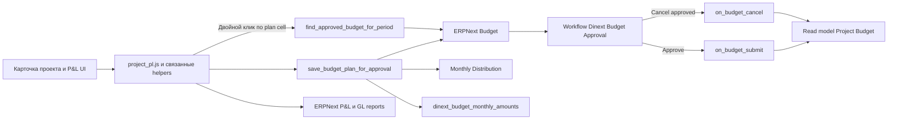

# Dinext Projects P&L

## 📖 Обзор

**Dinext Projects P&L** — это приложение для Frappe/ERPNext, которое расширяет стандартный DocType `Project` функциями проектного P&L, планирования, прогноза, отчетности и согласования бюджета.

Приложение объединяет кастомный P&L-интерфейс в карточке проекта с Dinext-логикой бюджетирования. Текущие плановые и прогнозные данные отображаются и редактируются в UI проекта, запросы на согласование создаются как стандартные ERPNext-документы `Budget` и `Monthly Distribution`, а согласованный план синхронизируется обратно в кастомный read model `Project Budget`. Точные утвержденные помесячные суммы хранятся отдельно от процентного `Monthly Distribution`, поэтому persisted-значения плана не дрейфуют из-за round-trip округления.

## ✨ Возможности

- **Кастомная вкладка P&L в `Project`** с таблицей трудозатрат/затрат, итоговыми блоками, кнопками отчетов и графиком.
- **Режимы просмотра план / прогноз / факт** с переключателями видимости плана и дельт.
- **Flow согласования бюджета**, в котором сохранение плана из P&L создает ERPNext `Budget`, а не пишет напрямую в `Project Budget`.
- **Гранулярность бюджета по ключу**: один `Budget` на сочетание `account + project/task + fiscal year`.
- **Workflow согласования Dinext** со специальными ролями:
  - `Dinext_Project_Manager` отправляет на согласование;
  - `Dinext_Budget_Approver` согласует и отменяет.
- **Семантика замещения**:
  - новый запрос отменяет существующий pending budget для того же канонического ключа;
  - согласование новой версии отменяет ранее согласованный budget для того же ключа.
- **Точное хранение approved monthly amounts** в скрытом поле `Budget.dinext_budget_monthly_amounts`, при этом `Monthly Distribution` остается производным ERPNext-артефактом.
- **Синхронизация `Project Budget`** на submit/cancel через app-owned Python hooks.
- **Навигация из P&L-таблицы**:
  - двойной клик по строке статьи/задачи открывает список `Budget`;
  - двойной клик по ячейке плановой суммы открывает соответствующий approved `Budget`;
  - двойной клик по ячейке факта открывает `General Ledger`.
- **Script Report** `Project Budget Plan vs Forecast` для сравнения плана с прогнозом и фактом.
- **Fixture-driven доставка метаданных** для workflow, workflow states, actions, roles, accounting dimensions, custom fields, client scripts и связанной metadata.

## 🚀 Установка

Установите приложение в существующий bench:

```bash
cd $PATH_TO_YOUR_BENCH
bench get-app $URL_OF_THIS_REPO --branch develop
bench install-app dinext_projects_pl
```

Затем примените изменения схемы и метаданных:

```bash
bench --site $SITE migrate
```

Приложение опирается на fixture-based доставку метаданных. При установке и миграции применяются custom fields, client/server scripts, accounting dimensions, workflow `Dinext Budget Approval`, workflow states/actions и роль `Dinext_Budget_Approver`.

## 🛠️ Использование

### Основной P&L-сценарий

1. Откройте документ `Project`.
2. Перейдите в кастомный раздел P&L.
3. Проверьте план, прогноз и факт по месяцам.
4. Нажмите `Сохранить план`.
5. Клиентский код вызывает app-owned Python service `save_budget_plan_for_approval`, который:
   - группирует строки по `account + target + fiscal year`;
   - создает `Budget` и `Monthly Distribution`;
   - сохраняет точные исходные помесячные суммы в metadata `Budget`;
   - переводит бюджет в Dinext workflow согласования.

### Согласование бюджета

- Pending budgets находятся в состоянии `Pending Approval`.
- При `Approve` бюджет submit'ится и синхронизируется в `Project Budget`.
- При согласовании replacement-версии ранее approved budget для того же канонического ключа отменяется, а новая версия становится источником истины.
- При отмене ранее approved budget read model либо восстанавливается из другого approved replacement, либо очищается по затронутым месяцам.

### UI-помощники

- Двойной клик по строке статьи/задачи в P&L открывает подходящие документы `Budget`.
- Двойной клик по ячейке плановой суммы открывает approved `Budget` для этого периода.
- Кнопки отчетов открывают ERPNext financial reports с фильтрами по проекту.

### Расширение меню прогноза

Другие приложения могут расширять выпадающее меню `Добавить прогноз` через глобальный реестр:

```javascript
frappe.provide("dinext_projects.project_pl_forecast_menu");
dinext_projects.project_pl_forecast_menu = dinext_projects.project_pl_forecast_menu || [];
dinext_projects.project_pl_forecast_menu.push({
  label: __("Мой прогноз"),
  action(frm) {
    // кастомная логика
  },
});
```

Если пункты добавлены после первичной отрисовки, вызовите `dinext_projects.refresh_pl_forecast_dropdown(frm)`.

## 📦 Технологии

- **Python 3.10+**
- **Frappe Framework**
- **ERPNext** (`Budget`, `Monthly Distribution`, финансовые отчеты)
- **JavaScript client scripts** для `Project`
- **Fixture-driven metadata** через `hooks.py`
- **Ruff**, **ESLint**, **Prettier** и **pre-commit** для локальной разработки

## 🔧 Конфигурация

Приложение не вводит собственные environment variables. Основная конфигурация выполняется через метаданные Frappe и стандартные ERPNext-сущности:

- fixtures для `Accounting Dimension`;
- custom fields в `Budget`:
  - `dinext_budget_account`;
  - `dinext_budget_monthly_amounts`;
  - `workflow_state`;
- workflow metadata для `Dinext Budget Approval`;
- custom fields и client scripts для UI проекта.

Важные эксплуатационные детали:

- `Monthly Distribution` — производный артефакт для monthly checks в ERPNext, а не источник истины для sync approved plan.
- Точные approved monthly amounts сохраняются прямо в `Budget`, чтобы исключить drift из-за round-trip округления.
- `Project Budget.pba_expected` остается независимым прогнозом и не перезаписывается автоматически при approve-sync.
- В репозитории по-прежнему присутствует fixture `server_script.json`, но основной путь согласования плана реализован в app-owned Python service, а не в site-only server script.

## ✅ Требования

- Рабочий **bench** с **Frappe**.
- Установленный **ERPNext** на целевом сайте для стандартных budget/report doctypes и их логики.
- **Python >= 3.10** согласно [pyproject.toml](pyproject.toml).
- Доступ к стандартным финансовым doctypes и отчетам, которые использует приложение.

## 🤝 Как вносить изменения

Подключите локальные проверки через `pre-commit`:

```bash
cd apps/dinext_projects_pl
pre-commit install
```

Основной инструментарий разработки:

- `ruff` для lint/format/import ordering Python-кода;
- `eslint` для JavaScript;
- `prettier` для форматирования фронтенда;
- `pyupgrade` для обновления синтаксиса Python.

Если нужно изменить metadata:

1. Вносите изменения через систему Frappe/ERPNext.
2. Затем выполняйте:

```bash
bench --site $SITE export-fixtures --app dinext_projects_pl
```

Не редактируйте generated fixture JSON-файлы вручную.

## 📄 Документация

- [README.md](README.md) — обзор репозитория и текущей архитектуры.
- [dinext_projects_pl/hooks.py](dinext_projects_pl/hooks.py) — wiring приложения, fixture filters и hooks.
- [dinext_projects_pl/dinext_projects_pl/budget_approval/service.py](dinext_projects_pl/dinext_projects_pl/budget_approval/service.py) — сервисы согласования бюджета и sync-логика.
- [dinext_projects_pl/dinext_projects_pl/budget_approval/bootstrap.py](dinext_projects_pl/dinext_projects_pl/budget_approval/bootstrap.py) — константы workflow, ролей и полей.
- [dinext_projects_pl/dinext_projects_pl/overrides/budget.py](dinext_projects_pl/dinext_projects_pl/overrides/budget.py) — override duplicate-validation для `Budget`.
- [dinext_projects_pl/dinext_projects_pl/doctype/project_budget/test_project_budget.py](dinext_projects_pl/dinext_projects_pl/doctype/project_budget/test_project_budget.py) — regression-тесты budget approval flow.

## ❤️ Благодарности

Приложение построено на Frappe и ERPNext budgeting/reporting primitives и адаптировано под Dinext-процессы проектных финансов.

## 🗂️ Структура репозитория

```text
.
├── README.md
├── license.txt
├── pyproject.toml
├── .pre-commit-config.yaml
├── .eslintrc
├── .editorconfig
└── dinext_projects_pl/
    ├── __init__.py
    ├── hooks.py
    ├── modules.txt
    ├── patches.txt
    ├── fixtures/
    │   ├── accounting_dimension.json
    │   ├── client_script.json
    │   ├── custom_field.json
    │   ├── role.json
    │   ├── server_script.json
    │   ├── workflow.json
    │   ├── workflow_action_master.json
    │   └── workflow_state.json
    ├── public/
    │   └── js/
    │       ├── project_pl.js
    │       ├── project_pl_calc.js
    │       ├── project_pl_dashboard.js
    │       └── project_pl_style.js
    └── dinext_projects_pl/
        ├── budget_approval/
        │   ├── __init__.py
        │   ├── bootstrap.py
        │   └── service.py
        ├── overrides/
        │   ├── __init__.py
        │   └── budget.py
        ├── doctype/
        │   ├── project_budget/
        │   ├── project_budget_amount/
        │   └── project_budget_dimension/
        ├── report/
        │   └── project_budget_plan_vs_forecast/
        └── tests/
            └── test_app_bootstrap.py
```

- `dinext_projects_pl/hooks.py` подключает client assets, fixtures, override для `Budget` и submit/cancel hooks.
- `dinext_projects_pl/fixtures/` содержит system-generated metadata, экспортированную из сайта.
- `dinext_projects_pl/public/js/` содержит UI проекта, агрегацию данных, рендеринг графика и интерактивные обработчики навигации.
- `dinext_projects_pl/dinext_projects_pl/budget_approval/` содержит app-owned flow согласования бюджета и sync с `Project Budget`.
- `dinext_projects_pl/dinext_projects_pl/overrides/` адаптирует duplicate-checks ERPNext `Budget` под Dinext replacement semantics.
- `dinext_projects_pl/dinext_projects_pl/doctype/` определяет кастомный read model `Project Budget`.
- `dinext_projects_pl/dinext_projects_pl/report/` содержит script report для сравнения плана и прогноза.
- `dinext_projects_pl/dinext_projects_pl/tests/` содержит тесты wiring и bootstrap-контрактов.

## 🔗 Схема потока



## 📝 История изменений

Последние значимые изменения на уровне репозитория:

- основной flow сохранения плана переведен с прямой записи в `Project Budget` на app-owned budget approval services;
- добавлены Dinext workflow fixtures для согласования `Budget`, включая отдельную роль согласующего и набор workflow states/actions;
- добавлено точное хранение approved monthly amounts в `Budget`, чтобы исключить round-trip drift при approve-sync;
- добавлено regression-покрытие для multi-month approval sync и replacement semantics.
