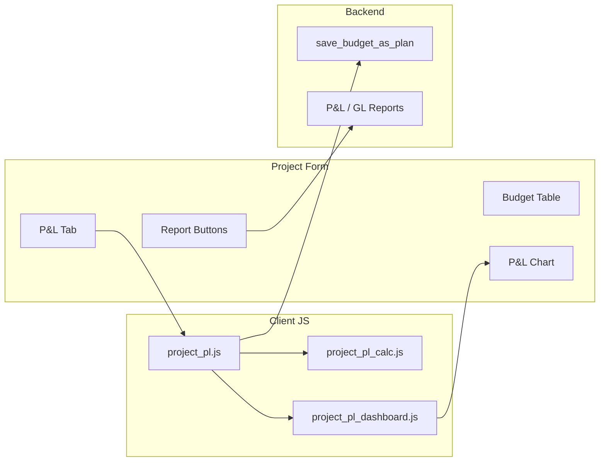

# Dinext Projects P&L

## Overview

**Dinext Projects P&L** is a Frappe/ERPNext app that extends the standard **Project** DocType with Profit & Loss (P&L) functionality. It adds planning and tracking of project budgets by period (plan, forecast, and actual), a dedicated P&L tab with a labour/cost table, integration with the standard Profit and Loss Statement and General Ledger reports, and charts. Plan and forecast data are stored in custom DocTypes and can be saved from the current forecast or actuals.

The app is intended for use in a Frappe or ERPNext bench; it relies on Accounting Dimensions (Task, Project Role, Business Area, Project Portfolio) and standard financial reports for full functionality.

## Features

- **Project form extension** — Custom tab "P&L" on the Project form with sections for financial result, summary, report buttons, chart periodicity, plan/forecast/actual toggle, and P&L chart.
- **Labour/cost planning table** — "Трудозатраты" (Labour) table with monthly columns for plan, forecast, and actual; view options "Прогноз и факт" / "Только прогноз" / "Только факт"; buttons "Сохранить план" (Save plan), "Показать план" (Show plan), "Показать Δ" (Show delta); extensible dropdown "Добавить прогноз" (Add forecast) via global registry `dinext_projects.project_pl_forecast_menu`.
- **Report integration** — Buttons to open **Profit and Loss Statement** ("Свод P&L") and **General Ledger** for Income and Expenses with filters set by project and date range.
- **P&L chart** — Period-based chart (income, expenses, profit, cumulative profit) driven by aggregated budget data on the form.
- **Custom DocTypes** — **Project Budget**, **Project Budget Amount**, **Project Budget Dimension** store plan and forecast data by account and accounting dimensions.
- **Save plan API** — Server Script `save_budget_as_plan` saves current forecast/actual data as plan into Project Budget (create/update documents and child tables).
- **Fixtures** — Custom Field (Project), Client Script, Server Script, and Accounting Dimension (Task, Project Role, Business Area, Project Portfolio) are shipped as fixtures and applied on install.
- **Accounting dimensions** — Budget aggregation and display support dimensions; dimension data is used in indexes and sums for the budget table and chart.

## Requirements

- **Frappe** (bench environment). The app is designed to run inside a bench with Frappe and, for report integration, typically ERPNext.
- **Python** >= 3.10 (see [pyproject.toml](pyproject.toml)).
- Application dependencies are managed by bench; no extra runtime dependencies are declared in the app package.

## Installation

Install the app with the [bench](https://github.com/frappe/bench) CLI:

```bash
cd $PATH_TO_YOUR_BENCH
bench get-app $URL_OF_THIS_REPO --branch develop
bench install-app dinext_projects_pl
```

After installation, fixtures (Custom Field, Client Script, Server Script, Accounting Dimension) are applied automatically, extending the Project form and registering the Server Script API.

## Usage

- **P&L tab** — Open a **Project** document and go to the **P&L** tab. Use the labour/cost table to view or edit plan/forecast/actual by period, change view options, show or hide plan and delta columns, and use "Сохранить план" to write current data as plan via the `save_budget_as_plan` API. Use the report buttons to open the P&L Statement or General Ledger with project and date filters.
- **Extending the forecast menu** — To add items to the "Добавить прогноз" dropdown, push entries to `dinext_projects.project_pl_forecast_menu` (each with `label` and `action(frm)`). If the menu is changed after the button is rendered, call `dinext_projects.refresh_pl_forecast_dropdown(frm)` to refresh the dropdown. See comments in [dinext_projects_pl/public/js/project_pl.js](dinext_projects_pl/public/js/project_pl.js).
- **Saving plan data** — "Сохранить план" confirms and then sends the current table data to the Server Script API `save_budget_as_plan`, which creates or updates **Project Budget** (and child **Project Budget Amount** / **Project Budget Dimension**) records.

## Technologies

- **Backend:** Python (Frappe), Server Script (Python in [dinext_projects_pl/fixtures/server_script.json](dinext_projects_pl/fixtures/server_script.json)).
- **Frontend:** JavaScript (form client scripts for Project), loaded via [dinext_projects_pl/hooks.py](dinext_projects_pl/hooks.py) `doctype_js`: `project_pl_style.js`, `project_pl.js`, `project_pl_calc.js`, `project_pl_dashboard.js`.
- **Stack:** Frappe/ERPNext, jQuery (form UI), Frappe Chart, standard Query Reports (Profit and Loss Statement, General Ledger).

## Configuration

The app does not introduce its own environment variables or config files. Accounting dimensions are defined in the standard **Accounting Dimension** DocType and are included in fixtures ([dinext_projects_pl/fixtures/accounting_dimension.json](dinext_projects_pl/fixtures/accounting_dimension.json)).

## Repository structure

```
dinext_projects_pl/                    # App package root
├── hooks.py                           # App hooks: fixtures, doctype_js for Project
├── modules.txt                        # Module list
├── patches.txt                        # DB migration patches
├── __init__.py
├── fixtures/                          # Fixtures applied on install
│   ├── custom_field.json              # Project custom fields (P&L tab, sections, buttons, chart)
│   ├── client_script.json             # Client scripts (module)
│   ├── server_script.json             # save_budget_as_plan API
│   └── accounting_dimension.json      # Task, Project Role, Business Area, Project Portfolio
├── public/
│   └── js/                            # Client JS for Project form
│       ├── project_pl_style.js         # Styles for budget table and controls
│       ├── project_pl.js               # P&L tab UI, budget table, forecast menu, save plan
│       ├── project_pl_calc.js         # Budget aggregation, indexes, sums (plan/forecast/fact)
│       └── project_pl_dashboard.js    # P&L chart, report buttons (P&L Statement, GL)
└── dinext_projects_pl/                # Python package
    └── doctype/
        ├── project_budget/            # Project Budget DocType
        ├── project_budget_amount/      # Child: amounts by period (year, month, plan, etc.)
        └── project_budget_dimension/  # Child: dimension links (doc, docname)

README.md
license.txt
pyproject.toml                         # Project metadata, ruff config
.pre-commit-config.yaml                # Pre-commit hooks (ruff, eslint, prettier, etc.)
.eslintrc
.editorconfig
```

## Flow chart

High-level flow: Project form (P&L tab) uses client JS to build the budget table and chart; "Сохранить план" calls the Server Script API, which updates Project Budget; report buttons open standard Query Reports with project filters.



## Contributing

This app uses **pre-commit** for formatting and linting. Install [pre-commit](https://pre-commit.com/#installation) and enable it in the app directory:

```bash
cd apps/dinext_projects_pl
pre-commit install
```

Pre-commit runs:

- **ruff** — import sort, lint, format (Python)
- **eslint** — JavaScript lint
- **prettier** — JavaScript/Vue/SCSS formatting
- **pyupgrade** — Python syntax upgrades

Config: [.pre-commit-config.yaml](.pre-commit-config.yaml), [pyproject.toml](pyproject.toml) (ruff), [.eslintrc](.eslintrc).

## License

MIT. See [license.txt](license.txt).

## Changelog

Recent changes (see git history for full log):

- Add refresh for project planning dropdown; improve task bucket handling in budget calculations.
- Fix dimension in parent budget limit return; update parent budget limit handling and error messages.
- Add delete for risk reserves in budget management; simplify budget calculation and risk handling.
- Fix risk display in budget columns; improve project budget controls and dropdown button.
- Add Project Budget DocType and related features; app initialization.
