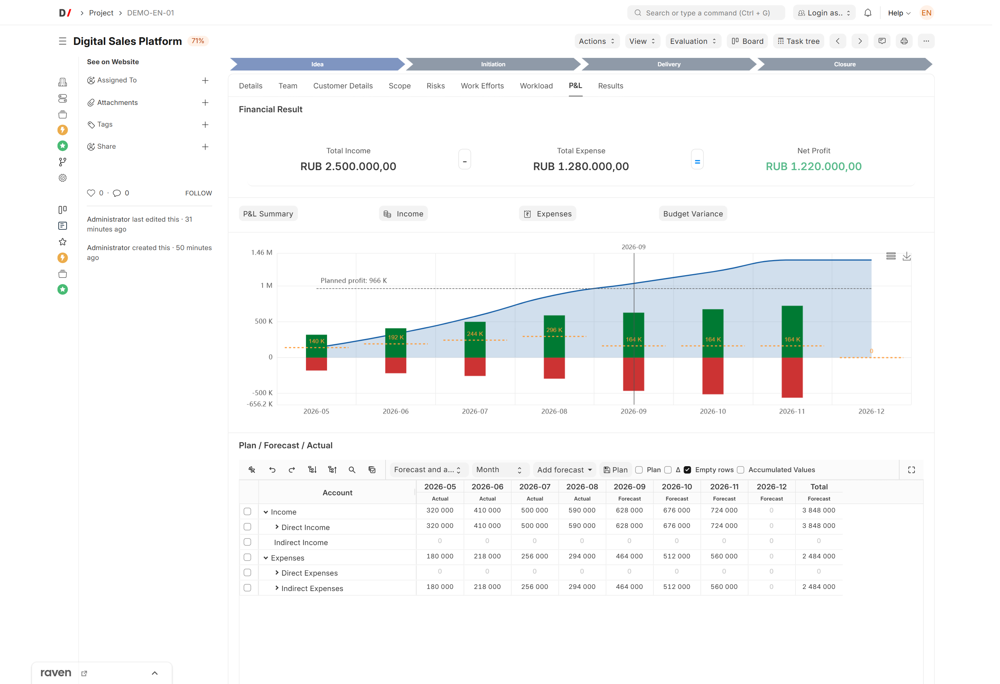
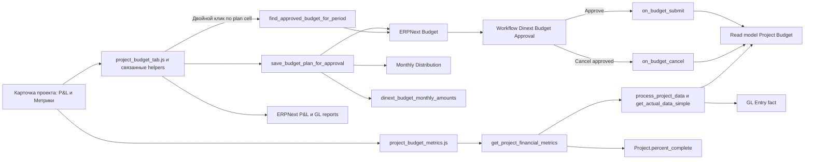
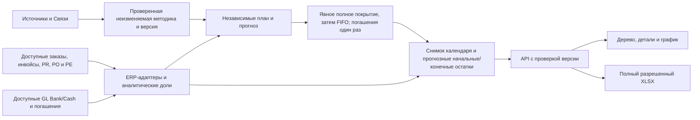

[English](README.md)

<!-- dinext-presentation:start -->
<p align="center">
  <a href="https://dinext.ru"></a>
</p>
<h1 align="center">Dinext Projects P&amp;L</h1>

<hr>

<p align="center">Планирование и контроль выручки, затрат, бюджетов и денежных потоков через проектный P&amp;L и платежный календарь.</p>

<p align="center">
  
</p>
<p align="center"><sub>P&amp;L, финансовый прогноз и бюджетные показатели учебного проекта.</sub></p>

<p align="center">
  <a href="https://dinext.ru">Сайт</a> · <a href="https://docs.dinext.ru">Документация</a>
</p>
<!-- dinext-presentation:end -->

# Dinext Projects P&L

## 📖 Обзор

**Dinext Projects P&L** — это приложение для Frappe/ERPNext, которое расширяет стандартный DocType `Project` функциями проектного P&L, планирования, прогноза, отчетности и согласования бюджета. После семантического разделения владеет финансовыми masters (`Cost Level`, `Rate Category` / `Rate Table`, `Account Table`, `Cost Center Table`, `Business Area`, `Project Payment Scheme`, `Worker Level`), rate-control reports, ролями `Dinext_Financier` / `Dinext_Fin_Dir` / `Dinext_Budget_Approver`, workspaces **Фин. Контроль** и **Аналитика**, а также Number Card **Коммерческие проекты**.

Приложение объединяет кастомный P&L-интерфейс и отдельную вкладку `Метрики` в карточке проекта с Dinext-логикой бюджетирования. Текущие плановые и прогнозные данные отображаются и редактируются в UI проекта, EVM-показатели рассчитываются на сервере через единый whitelisted API и отображаются на вкладке `Метрики`, а сохранение плана работает в двух режимах: через стандартные ERPNext-документы `Budget` и `Monthly Distribution` с workflow согласования либо через прямую запись в кастомный read model `Project Budget`. Точные утвержденные помесячные суммы хранятся отдельно от процентного `Monthly Distribution`, поэтому persisted-значения плана не дрейфуют из-за round-trip округления.

Платежный календарь добавляет просмотр денежных потоков компании, независимые план/прогноз, прогнозные остатки и детализацию источников. Источники и связи уточнения настраиваются; самостоятельные заявки покрываются по фиксированному FIFO без изменения финансовых документов.

## ✨ Возможности

- **Платежный календарь** с настраиваемыми Источниками/Связями, фиксированным FIFO, прогнозными начальными/конечными остатками по настройкам, графиком денег, детализацией с проверкой прав и полным XLSX.
- **Кастомная вкладка P&L в `Project`** с таблицей трудозатрат/затрат, итоговыми блоками, кнопками отчетов и графиком.
- **Отдельная вкладка `Метрики` в `Project`** с финансовыми EVM-метриками по контурам доходов и расходов, отчетной датой расчета и серверным расчетом `BAC/PV/EV/AC/CV/SV/CPI/SPI/EAC/ETC/VAC/TCPI`.
- **Единый серверный API EVM-метрик** `get_project_financial_metrics`, переиспользующий агрегацию plan/fact из report pipeline и возвращающий готовый payload для UI.
- **Режимы просмотра план / прогноз / факт** с переключателями видимости плана и дельт.
- **Flow согласования бюджета**, в котором сохранение плана из P&L создает ERPNext `Budget`, а не пишет напрямую в `Project Budget`, если site-level toggle согласования включен.
- **Site-level toggle сохранения плана**: можно переключить режим между workflow согласования и прямым сохранением `pba_plan` без `Budget` и workflow.
- **Гранулярность бюджета по ключу**: один `Budget` на сочетание `account + project/task + fiscal year`.
- **Workflow согласования Dinext** со специальными ролями:
  - `Dinext_Project_Manager` отправляет на согласование;
  - `Dinext_Budget_Approver` согласует и отменяет.
- **Семантика замещения**:
  - новый запрос отменяет существующий pending budget для того же канонического ключа;
  - согласование новой версии отменяет ранее согласованный budget для того же ключа.
- **Точное хранение approved monthly amounts** в скрытом поле `Budget.dinext_budget_monthly_amounts`, при этом `Monthly Distribution` остается производным ERPNext-артефактом.
- **Синхронизация `Project Budget`** на submit/cancel через app-owned Python hooks.
- **Навигация из P&L-таблицы**:
  - двойной клик по строке статьи/задачи открывает список `Budget`;
  - двойной клик по ячейке плановой суммы открывает соответствующий approved `Budget`;
  - двойной клик по ячейке факта открывает `General Ledger`.
- **Script Report** `Project Budget Plan vs Forecast` для сравнения плана с прогнозом и фактом.
- **Workspace «Аналитика»** (вложенный под «Мои проекты») с финансовыми number cards/charts и shortcuts на ERPNext reports; Number Card **«Коммерческие проекты»** поставляется этим приложением.
- **Fixture-driven доставка метаданных** для workflow, workflow states, actions, roles, accounting dimensions, custom fields, client scripts и связанной metadata.

## 🚀 Установка

Установите приложение в существующий bench:

```bash
cd $PATH_TO_YOUR_BENCH
bench get-app https://github.com/Dinext-pro/dinext-projects-pl --branch develop
bench --site "$SITE" install-app dinext_projects_pl
```

Затем примените изменения схемы и метаданных:

```bash
bench --site "$SITE" migrate
bench build --app dinext_projects_pl
bench --site "$SITE" clear-cache
```

Приложение опирается на fixture-based и module JSON доставку метаданных. При установке и миграции применяются custom fields, client/server scripts, accounting dimensions, workflow `Dinext Budget Approval`, workflow states/actions, финансовые роли, workspaces «Фин. Контроль» / «Аналитика», number cards/charts и rate-control reports.

`required_apps`: `dinext_common`, `doctype_permission`, `dinext_projects`.

Эти команды предназначены для development-сайта; укажите его существующее имя в `SITE`. Для установленного checkout обновите проверенный ref и выполните migrate/build/clear-cache; это не инструкция production-выкладки. Повторные миграции сохраняют настройки календаря и идемпотентно создают индексы GL/PLE. После изменения ресурсов обновите Desk.

## 🛠️ Использование

### Платежный календарь

Откройте **Платежный календарь** (`Liquidity Payment Calendar`) из **Аналитики**, **Фин. контроля** или поиска отчетов Desk. Маршрут: `/app/query-report/Liquidity%20Payment%20Calendar`.

1. Выберите компанию, диапазон дат и шаг день/неделя/месяц. Уточните выборку по проекту, портфелю, типу/имени контрагента или денежному счету Bank/Cash.
2. Выберите порядок группировки: сначала проект, сначала контрагент или **Только контрагент**. Уровни контракта, заказа, инвойса и платежного документа сохраняются ниже выбранной группировки.
3. Используйте **Прогноз и факт**, **Только факт** или **Только прогноз**; **План** включается отдельно. В совмещенном режиме завершенные периоды показывают факт, текущий и будущие — прогноз, без сложения стадий.
4. Раскрывайте уровни пакетно, выделяйте суммы для статистики, дважды нажимайте на сумму для детализации или на связанное название для перехода к документу.
5. Сопоставьте остатки и график денежных потоков; кнопка XLSX находится непосредственно слева от Fullscreen таблицы. Заголовки детализации закреплены при прокрутке. Поддерживаются обе темы Desk и смена темы без перезагрузки.

Календарь работает только на чтение. Он пересчитывается по доступным первичным документам, не изменяет их и не хранит отдельный реестр распределений. Фактические денежные потоки и фактический начальный остаток берутся из разрешенных проводок `GL Entry` по счетам Bank/Cash. План и прогноз рассчитываются независимо по **Payment Calendar Settings**. Все прогнозные остатки, включая начальный до отображаемого диапазона, учитывают те же ожидаемые движения из настроек; при неполной или ограниченной видимости денежных средств компании остатки компании скрываются, чтобы не выдавать частичную сумму за полную.

Самостоятельные Payment Request покрываются инвойсами по фиксированному FIFO после явных связей. Для сопоставления совпадают компания, направление, тип/имя контрагента, проект, контракт и исходная валюта; пустая аналитика совпадает с пустой. Общий заказ необязателен, противоречащие ссылки на заказы запрещают сопоставление. Инвойс может предшествовать заявке. Покрытие рассчитывается по полной сумме обязательств с сохранением оплаченных и внепериодных документов; погашения вычитаются после распределения один раз. Заявка `100`, инвойс `60` и оплата инвойса `20` дают прогноз `40` непокрытой заявки + `40` долга инвойса = **80**. Очередь FIFO упорядочивается по `transaction_date` заявки / `posting_date` инвойса, затем `creation` и `name`, отсутствующие даты — последними; выбор поля ожидаемой даты не меняет этот фиксированный порядок.

Payment Order и черновики Payment Entry уточняют покрытые сумму/дату согласно настроенным связям и приоритетам. Валютный пересчет разделяет оценку ожидаемых денег и балансовую стоимость обязательства; следующая инструкция не может повторно использовать одну долю обязательства. Проведенные оплаты сохраняются как бухгалтерские данные и погашения, даже если исключены из ожидаемых источников.

XLSX строится по всему разрешенному дереву независимо от раскрытых строк. В нем есть листы календаря, компонентов, параметров и распределений, а при доступности — остатков. Параметры включают снимок/версию настроек и идентификатор алгоритма FIFO; распределения содержат разрешенные явные связи и FIFO-покрытие. Денежные ячейки остаются числовыми с расчетной точностью, текст, похожий на формулу, экранируется.

#### API платежного календаря

Префикс методов — `dinext_projects_pl.liquidity.api.`; контракты фильтров и ответов находятся в [liquidity/contracts.py](dinext_projects_pl/liquidity/contracts.py) и [liquidity/model.py](dinext_projects_pl/liquidity/model.py).

| Метод | Контракт |
| --- | --- |
| `get_calendar` | Начальный разрешенный снимок; возвращает `settings_version`, строки, периоды, KPI, предупреждения и доступные остатки. |
| `get_children` | Возвращает `{rows, settings_version}` для узла; передается начальная `expected_settings_version`. |
| `get_cell_details` | Ограниченная страница разрешенных компонентов ячейки; передается та же ожидаемая версия. |
| `export_liquidity_calendar` | Скачивает книгу по полной разрешенной области; передается та же ожидаемая версия. |
| `get_options` | Подсказки компаний, проектов, портфелей, счетов и контрагентов с проверкой прав. |
| `get_settings_catalog` | Допустимые поля дат и статусы источников; доступен только уполномоченным настройщикам. |

Для последующих браузерных запросов отсутствие или устаревшая `expected_settings_version` возвращает HTTP `409` с `error: "calendar_settings_changed"`. Обновите календарь и повторите запрос с новой версией; не смешивайте старые строки с новыми настройками. Остальные ошибки обрабатываются штатным механизмом Frappe.

### Основной P&L-сценарий

1. Откройте документ `Project`.
2. Перейдите в кастомный раздел P&L.
3. Проверьте план, прогноз и факт по месяцам.
4. Нажмите `Сохранить план`.
5. Клиентский код вызывает app-owned Python service `save_budget_plan_for_approval`, который группирует строки по `account + target + fiscal year`, а затем:
   - **при включенном согласовании** создает `Budget` и `Monthly Distribution`, сохраняет точные исходные помесячные суммы в metadata `Budget` и переводит бюджет в Dinext workflow согласования;
   - **если отключен site-level toggle** — сразу обновляет `Project Budget.pba_plan` без создания `Budget` и без workflow.

### Сценарий просмотра метрик

1. Откройте документ `Project`.
2. Перейдите на вкладку `Метрики`.
3. Выберите `Отчетная дата метрик`.
4. Клиентский код вызывает серверный API `get_project_financial_metrics`, который:
   - собирает помесячный plan из `Project Budget` через `process_project_data`;
   - собирает fact из `GL Entry` через `get_actual_data_simple`;
   - рассчитывает EVM-показатели на выбранную отчетную дату с proration текущего месяца.
5. Проверьте EVM-показатели по двум контурам:
   - `Доходы`;
   - `Расходы`.
6. Используйте показатели `BAC`, `PV`, `EV`, `AC`, `CV`, `SV`, `CPI`, `SPI`, `EAC`, `ETC`, `VAC`, `TCPI` для анализа исполнения проекта на выбранную дату.

Пример программного вызова API:

```python
frappe.call(
    "dinext_projects_pl.dinext_projects_pl.financial_metrics.service.get_project_financial_metrics",
    project="PROJ-0001",
    reporting_date="2026-01-15",
)
```

```javascript
frappe.call({
    method: "dinext_projects_pl.dinext_projects_pl.financial_metrics.service.get_project_financial_metrics",
    args: {
        project: frm.doc.name,
        reporting_date: frm._financial_metrics_reporting_date,
    },
});
```

### Согласование бюджета

- Режим согласования управляется site config ключом `dinext_projects_pl_enable_plan_approval`.
- Если ключ равен `1`, используется approval flow через `Budget`.
- Если ключ равен `0`, план сохраняется напрямую в `Project Budget`, а workflow согласования не запускается.
- Pending budgets находятся в состоянии `Pending Approval`.
- При `Approve` бюджет submit'ится и синхронизируется в `Project Budget`.
- При согласовании replacement-версии ранее approved budget для того же канонического ключа отменяется, а новая версия становится источником истины.
- При отмене ранее approved budget read model либо восстанавливается из другого approved replacement, либо очищается по затронутым месяцам.

### UI-помощники

- Двойной клик по строке статьи/задачи в P&L открывает подходящие документы `Budget`.
- Двойной клик по ячейке плановой суммы открывает approved `Budget` для этого периода.
- Кнопки отчетов открывают ERPNext financial reports с фильтрами по проекту.

### Расширение меню прогноза

Другие приложения могут расширять выпадающее меню `Добавить прогноз` через глобальный реестр:

```javascript
frappe.provide("dinext_projects.project_budget_forecast_menu");
dinext_projects.project_budget_forecast_menu =
  dinext_projects.project_budget_forecast_menu || [];
dinext_projects.project_budget_forecast_menu.push({
  label: __("Мой прогноз"),
  action(frm) {
    // кастомная логика
  },
});
```

Если пункты добавлены после первичной отрисовки, вызовите
`dinext_projects.refresh_project_budget_forecast_dropdown(frm)`.

Для cutover со старым risk доступны aliases: `project_pl_forecast_menu` и
`refresh_pl_forecast_dropdown` (тот же массив / та же функция).

## 📦 Технологии

- **Python 3.10+**
- **Frappe Framework 15**
- **ERPNext 15** (`Budget`, `Monthly Distribution`, финансовые отчеты)
- **AG Grid / DinextTable и ECharts** из `dinext_common`, загружаемые в активном отчете
- **JavaScript client scripts** для `Project`
- **Fixture-driven metadata** через `hooks.py`
- **Ruff**, **ESLint**, **Prettier** и **pre-commit** для локальной разработки

## 🔧 Конфигурация

Приложение не вводит собственные environment variables. Основная конфигурация выполняется через метаданные Frappe, `site_config.json` и стандартные ERPNext-сущности:

- `site_config.json`:
  - `dinext_projects_pl_enable_plan_approval` — включает (`1`) или отключает (`0`, default) сохранение плана через `Budget` workflow.
- Пример настройки:

```bash
bench --site $SITE set-config dinext_projects_pl_enable_plan_approval 0
```

При выключенном ключе кнопка `Сохранить план` продолжает использовать тот же серверный API, но он пишет значения напрямую в `Project Budget.pba_plan` и не создает `Budget` / `Monthly Distribution`.

- fixtures для `Accounting Dimension`;
- custom fields в `Budget`:
  - `dinext_budget_account`;
  - `dinext_budget_monthly_amounts`;
  - `workflow_state`;
- workflow metadata для `Dinext Budget Approval`;
- custom fields и client scripts для UI проекта, включая вкладки `P&L` и `Метрики`.

Важные эксплуатационные детали:

- `Monthly Distribution` — производный артефакт для monthly checks в ERPNext, а не источник истины для sync approved plan.
- Точные approved monthly amounts сохраняются прямо в `Budget`, чтобы исключить drift из-за round-trip округления.
- При `dinext_projects_pl_enable_plan_approval = 0` источником истины для новых операций `Сохранить план` сразу становится `Project Budget.pba_plan`, без промежуточного `Budget`.
- `Project Budget.pba_expected` остается независимым прогнозом и не перезаписывается автоматически при approve-sync.
- EVM-метрики используют только `pba_plan` и факт из `GL Entry`; прогноз (`pba_expected`) в расчет EVM не входит.
- Отчетная дата EVM передается в API явно; proration текущего месяца выполняется на сервере.
- В репозитории по-прежнему присутствует fixture `server_script.json`, но основной путь согласования плана реализован в app-owned Python service, а не в site-only server script.

### Payment Calendar Settings

Откройте Single **Payment Calendar Settings** через поиск Desk. В нем только два бизнес-раздела: **Источники** и **Связи**. Для настройки нужны стандартное право записи и роль **System Manager** или **Accounts Manager**. Обычному пользователю отчета прямой доступ к этой форме не требуется; его права на компанию, проекты и исходные документы продолжают действовать.

В **Источниках** отдельная строка задается для каждой пары показатель/DocType. Она управляет участием в плане, прогнозе или обоих; включением; приоритетом; состоянием документа Draft/Submitted/Both; допустимыми бизнес-статусами; полем ожидаемой даты и резервным вариантом. Поля дат берутся из установленных метаданных Date/Datetime и поддерживаемых графиков оплаты. Пустой выбор бизнес-статусов принимает все статусы, разрешенные состоянием документа; отмененные документы всегда исключены.

Отсутствующая строка источника не участвует в соответствующем показателе; любая включенная связь должна ссылаться на настроенные строки источников.

**Связи** задают направленное уточнение отдельно для плана и прогноза. Связи идут по строго возрастающим приоритетам; дубликаты источников/связей, неподдерживаемые поля/статусы и циклы отклоняются. Несопоставленная сумма остается самостоятельной ожидаемой суммой. **Параметров FIFO в Settings нет**: поля сопоставления, полная база покрытия, даты/порядок очереди и первенство явных связей закреплены в коде.

Начальный профиль: четырнадцать строк источников, семь на показатель; тридцать восемь прямых связей между приоритетами:

| Источник | Изначально включен в | Состояние документа | Ожидаемая дата / резерв |
| --- | --- | --- | --- |
| `Sales Order`, `Purchase Order` | План | Submitted | `payment_schedule` / `undated` |
| `Sales Invoice`, `Purchase Invoice` | Прогноз | Submitted | `payment_schedule` / `due_date` |
| `Payment Request` | Прогноз | Submitted; начальный набор бизнес-статусов исключает Draft, Cancelled и Failed | `transaction_date` / `previous` |
| `Payment Order` | Прогноз | Submitted | `posting_date` / `previous` |
| `Payment Entry` | Прогноз | **Только Draft** | `posting_date` / `previous` |

Миграция создает профиль только при одновременно пустых Источниках и Связях; сохраненные профили, в том числе намеренно выключенные источники, не перезаписываются. Некорректный/пустой сохраненный профиль вызывает диагностику вместо скрытых настроек по умолчанию. Один расчет загружает одну неизменяемую методику и версию содержимого; таблица, детали, график, прогнозные начальные/конечные остатки и XLSX используют эту методику. Переключение источников не изменяет фактические деньги GL и фактические начальные остатки.

### Ограничения календаря и проверка

Один расчет охватывает одну компанию. Денежные значения рассчитываются в валюте компании; исходная валюта и аналитическое происхождение доступны в деталях. Недостаточные права на источники или неоднозначные распределения вызывают предупреждения и могут скрывать остатки компании; сужение выборки не разрешает раскрывать скрытые доли.

Полный benchmark на 10 000 источников использует 2 000 цепочек, 4 000 строк Payment Order, два проекта/контрагента, реальные GL/PLE и обычного финансиста. После прогрева проверяются пять запросов сводки с порогом `5 s` и пять детализации с порогом `2 s`, полнота данных, суммы и количество запросов. Hosted-окружение приемки прошло эти пороги; локальная детализация превышала `2 s`. Результат относится к конкретному окружению и не гарантирует такую скорость на каждой машине. Финансовые снимки между запросами не кешируются.

## ✅ Требования

- Development bench с **Frappe 15 / ERPNext 15**, MariaDB, Redis и тремя обязательными Dinext-приложениями на сайте. Зависимостями framework управляет bench; workflow приемки закрепляет их версии.
- **Node.js** и **Yarn** для сборки и тестов; hosted-workflow приемки использует Node 20 и Python 3.11.
- **openpyxl** в окружении bench для XLSX (поставляется окружением ERPNext).
- Установленный **ERPNext** на целевом сайте для стандартных budget/report doctypes и их логики.
- **Python >= 3.10** согласно [pyproject.toml](pyproject.toml).
- Доступ к стандартным финансовым doctypes и отчетам, которые использует приложение.

## 🤝 Как вносить изменения

Перед изменениями следуйте [AGENTS.md](AGENTS.md) и центральным правилам разработки/OpenSpec Dinext. Обновляйте английский и русский README в одном PR. Изменения исходников предлагаются из feature-ветки в `develop`; merge, выпуск и production-выкладка требуют отдельных решений.

Подключите локальные проверки через `pre-commit`:

```bash
cd apps/dinext_projects_pl
pre-commit install
```

Основной инструментарий разработки:

- `ruff` для lint/format/import ordering Python-кода;
- `eslint` для JavaScript;
- `prettier` для форматирования фронтенда;
- `pyupgrade` для обновления синтаксиса Python.

Если нужно изменить metadata:

1. Сначала прочитайте текущие системные метаданные через MCP. Поля своих DocType меняйте в стандартном DocType, Custom Field/Property Setter используйте для чужих DocType. При необходимом fallback из-за недоступности MCP зафиксируйте причину и проверьте migrate/save/reload.
2. Затем выполняйте:

```bash
bench --site $SITE export-fixtures --app dinext_projects_pl
```

Не редактируйте generated fixture JSON-файлы вручную.

Запуск regression-тестов:

```bash
bench --site $SITE run-tests --app dinext_projects_pl
node --test tests/js/project_pl_financial_metrics.test.js
node --test tests/js/project_pl_echarts.test.js
```

### Тесты календаря и изолированная приемка

Серверные тесты проверяют расчеты, FIFO, валюты, сохранение/перезагрузку настроек, разрешенные и запрещенные операции, начальные остатки, конфликты версий и XLSX. Cypress проверяет отчет и Settings, обе темы/переключение без перезагрузки, скачивание XLSX, переходы между отчетами и регрессию отложенного открытия P&L. Используйте изолированный development-сайт с включенными тестами, установленными зависимостями и `DEV_SERVER=1` для браузерных тестовых методов. Cypress берется из Frappe; ключ Cypress Cloud и `--parallel` не нужны.

```bash
# Из корня bench, выбрав нужный development-сайт:
bench --site "$SITE" run-tests --app dinext_projects_pl
bench --site "$SITE" run-tests --doctype "Payment Calendar Settings"

# Из apps/dinext_projects_pl:
node --test tests/js/*.test.js tests/js/*.test.mjs

# Из корня bench, когда тот же изолированный сайт запущен с DEV_SERVER=1:
bench --site "$SITE" run-ui-tests dinext_projects_pl --headless --browser electron

# После очистки браузерных тестовых данных; только CLI:
bench --site "$SITE" execute dinext_projects_pl.tests.liquidity_ui_helpers.bootstrap
bench --site "$SITE" execute dinext_projects_pl.tests.liquidity_benchmark.run \
  --kwargs '{"chains": 2000, "repetitions": 5}'
bench --site "$SITE" execute dinext_projects_pl.tests.liquidity_ui_helpers.cleanup
```

Запускайте операции на сайте последовательно. Benchmark откатывает свой финансовый набор и сохраняет замеры, окружение и отпечаток кода в `/tmp/liquidity-benchmark.json`; bootstrap/cleanup создают и удаляют собственных синтетических пользователей и настройки и не предназначены для production. После ошибки обязательно выполните cleanup. Приложение не добавляет production-секреты или действие развертывания.

[Dinext acceptance](.github/workflows/dinext-acceptance.yml) создает временный bench, запускает полный серверный набор, требует все 63 браузерных сценария без пропусков/ошибок и затем проверяет все десять замеров на 10k. В артефактах сохраняются JUnit, скриншоты и метаданные benchmark. Стандартная validation и доверенная Dinext policy остаются отдельными обязательными проверками; ручной success их не заменяет.

## 📄 Документация

- [liquidity/](dinext_projects_pl/liquidity/api.py) — типизированный API календаря, ERP-адаптеры с проверкой прав, независимые расчеты и фиксированный FIFO.
- [Payment Calendar Settings](dinext_projects_pl/dinext_projects_pl/doctype/payment_calendar_settings/payment_calendar_settings.json) — стандартный Single, дочерние Источники/Связи и тесты настроек.
- [Liquidity Payment Calendar](dinext_projects_pl/dinext_projects_pl/report/liquidity_payment_calendar/liquidity_payment_calendar.js) — метаданные отчета, серверный fallback и scoped-интерфейс Desk.
- [Интеграционные тесты календаря](dinext_projects_pl/tests/test_liquidity_integration.py), [сценарии Cypress](cypress/integration/liquidity_payment_calendar.js) и [benchmark](dinext_projects_pl/tests/liquidity_benchmark.py) — воспроизводимая приемка.


- [README.md](README.md) — обзор репозитория и текущей архитектуры.
- [dinext_projects_pl/hooks.py](dinext_projects_pl/hooks.py) — wiring приложения, fixture filters и hooks.
- [dinext_projects_pl/dinext_projects_pl/budget_approval/service.py](dinext_projects_pl/dinext_projects_pl/budget_approval/service.py) — сервисы согласования бюджета и sync-логика.
- [dinext_projects_pl/dinext_projects_pl/financial_metrics/service.py](dinext_projects_pl/dinext_projects_pl/financial_metrics/service.py) — whitelisted API расчета EVM-метрик проекта.
- [dinext_projects_pl/dinext_projects_pl/financial_metrics/data.py](dinext_projects_pl/dinext_projects_pl/financial_metrics/data.py) — серверная агрегация plan/fact по месяцам для EVM.
- [dinext_projects_pl/dinext_projects_pl/financial_metrics/calculations.py](dinext_projects_pl/dinext_projects_pl/financial_metrics/calculations.py) — формулы EVM и формирование response payload.
- [dinext_projects_pl/public/js/project_budget_metrics.js](dinext_projects_pl/public/js/project_budget_metrics.js) — клиентский render-слой вкладки `Метрики`.
- [dinext_projects_pl/dinext_projects_pl/budget_approval/bootstrap.py](dinext_projects_pl/dinext_projects_pl/budget_approval/bootstrap.py) — константы workflow, ролей и полей.
- [dinext_projects_pl/dinext_projects_pl/overrides/budget.py](dinext_projects_pl/dinext_projects_pl/overrides/budget.py) — override duplicate-validation для `Budget`.
- [dinext_projects_pl/tests/test_project_budget.py](dinext_projects_pl/tests/test_project_budget.py) — regression-тесты budget approval flow.
- [dinext_projects_pl/tests/test_financial_metrics_service.py](dinext_projects_pl/tests/test_financial_metrics_service.py) — unit/integration-тесты серверного расчета EVM-метрик.
- [tests/js/project_pl_financial_metrics.test.js](tests/js/project_pl_financial_metrics.test.js) — JS-тесты render-слоя вкладки `Метрики`.
- [tests/js/project_pl_echarts.test.js](tests/js/project_pl_echarts.test.js) — JS-тесты P&L ECharts (palette, tooltip, markLine, toolbox, geometry).

## 🗂️ Структура репозитория

<details>
<summary>Полное дерево отслеживаемых файлов этого checkout</summary>

```text
.
├── .cursor/
│   ├── commands/
│   │   ├── opsx-apply.md
│   │   ├── opsx-archive.md
│   │   ├── opsx-explore.md
│   │   ├── opsx-propose.md
│   │   ├── opsx-sync.md
│   │   └── opsx-update.md
│   └── rules/
│       └── dinext-central-first.mdc
├── .github/
│   ├── ci/
│   │   └── liquidity_ui.py
│   ├── imported-workflows-disabled/
│   │   └── linters.yml
│   ├── workflows/
│   │   ├── dinext-acceptance.yml
│   │   ├── dinext-policy.yml
│   │   └── dinext-validation.yml
│   ├── CI.md
│   ├── HISTORY-CLEANUP.md
│   └── dinext-ci.json
├── .issues/
│   └── ISS-2026-00926/
│       └── try3/
│           └── pl/
│               ├── decisions.md
│               ├── implementation-plan.md
│               ├── index.md
│               ├── legacy-cutover.md
│               ├── legacy-inventory.md
│               └── obsolete-cleanup.md
├── cypress/
│   ├── integration/
│   │   └── liquidity_payment_calendar.js
│   └── support/
│       ├── commands.js
│       └── e2e.js
├── dinext_projects_pl/
│   ├── config/
│   │   └── __init__.py
│   ├── dinext_projects_pl/
│   │   ├── budget_approval/
│   │   │   ├── __init__.py
│   │   │   ├── bootstrap.py
│   │   │   └── service.py
│   │   ├── dashboard_chart/
│   │   │   ├── выручка_по_клиентам/
│   │   │   │   └── выручка_по_клиентам.json
│   │   │   └── доходы_и_расходы/
│   │   │       └── доходы_и_расходы.json
│   │   ├── doctype/
│   │   │   ├── account_table/
│   │   │   │   ├── __init__.py
│   │   │   │   ├── account_table.json
│   │   │   │   └── account_table.py
│   │   │   ├── business_area/
│   │   │   │   ├── __init__.py
│   │   │   │   ├── business_area.js
│   │   │   │   ├── business_area.json
│   │   │   │   ├── business_area.py
│   │   │   │   └── test_business_area.py
│   │   │   ├── cost_business_area/
│   │   │   │   ├── __init__.py
│   │   │   │   ├── cost_business_area.json
│   │   │   │   └── cost_business_area.py
│   │   │   ├── cost_center_table/
│   │   │   │   ├── __init__.py
│   │   │   │   ├── cost_center_table.json
│   │   │   │   └── cost_center_table.py
│   │   │   ├── cost_level/
│   │   │   │   ├── __init__.py
│   │   │   │   ├── cost_level.js
│   │   │   │   ├── cost_level.json
│   │   │   │   ├── cost_level.py
│   │   │   │   └── test_cost_level.py
│   │   │   ├── payment_calendar_link/
│   │   │   │   ├── __init__.py
│   │   │   │   ├── payment_calendar_link.json
│   │   │   │   └── payment_calendar_link.py
│   │   │   ├── payment_calendar_settings/
│   │   │   │   ├── __init__.py
│   │   │   │   ├── payment_calendar_settings.js
│   │   │   │   ├── payment_calendar_settings.json
│   │   │   │   ├── payment_calendar_settings.py
│   │   │   │   └── test_payment_calendar_settings.py
│   │   │   ├── payment_calendar_source/
│   │   │   │   ├── __init__.py
│   │   │   │   ├── payment_calendar_source.json
│   │   │   │   └── payment_calendar_source.py
│   │   │   ├── project_budget/
│   │   │   │   ├── __init__.py
│   │   │   │   ├── project_budget.js
│   │   │   │   ├── project_budget.json
│   │   │   │   └── project_budget.py
│   │   │   ├── project_budget_amount/
│   │   │   │   ├── __init__.py
│   │   │   │   ├── project_budget_amount.json
│   │   │   │   └── project_budget_amount.py
│   │   │   ├── project_budget_dimension/
│   │   │   │   ├── __init__.py
│   │   │   │   ├── project_budget_dimension.json
│   │   │   │   └── project_budget_dimension.py
│   │   │   ├── project_payment_scheme/
│   │   │   │   ├── __init__.py
│   │   │   │   ├── project_payment_scheme.js
│   │   │   │   ├── project_payment_scheme.json
│   │   │   │   ├── project_payment_scheme.py
│   │   │   │   └── test_project_payment_scheme.py
│   │   │   ├── rate_category/
│   │   │   │   ├── __init__.py
│   │   │   │   ├── rate_category.js
│   │   │   │   ├── rate_category.json
│   │   │   │   ├── rate_category.py
│   │   │   │   └── test_rate_category.py
│   │   │   ├── rate_table/
│   │   │   │   ├── __init__.py
│   │   │   │   ├── rate_table.json
│   │   │   │   └── rate_table.py
│   │   │   ├── worker_level/
│   │   │   │   ├── __init__.py
│   │   │   │   ├── worker_level.json
│   │   │   │   └── worker_level.py
│   │   │   └── __init__.py
│   │   ├── financial_metrics/
│   │   │   ├── __init__.py
│   │   │   ├── calculations.py
│   │   │   ├── constants.py
│   │   │   ├── data.py
│   │   │   └── service.py
│   │   ├── number_card/
│   │   │   ├── выручка/
│   │   │   │   └── выручка.json
│   │   │   ├── заявок_ec_на_согласовании/
│   │   │   │   └── заявок_ec_на_согласовании.json
│   │   │   ├── заявок_ec_отклонено/
│   │   │   │   └── заявок_ec_отклонено.json
│   │   │   ├── заявок_ec_согласованных_мной/
│   │   │   │   └── заявок_ec_согласованных_мной.json
│   │   │   ├── заявок_ec_согласовано/
│   │   │   │   └── заявок_ec_согласовано.json
│   │   │   ├── заявок_ec_у_меня_на_согласовании/
│   │   │   │   └── заявок_ec_у_меня_на_согласовании.json
│   │   │   ├── коммерческие_проекты/
│   │   │   │   └── коммерческие_проекты.json
│   │   │   └── расходы/
│   │   │       └── расходы.json
│   │   ├── overrides/
│   │   │   ├── __init__.py
│   │   │   └── budget.py
│   │   ├── project_budget/
│   │   │   ├── __init__.py
│   │   │   ├── amounts.py
│   │   │   ├── dimensions.py
│   │   │   ├── grid_data.py
│   │   │   ├── periods.py
│   │   │   ├── plan_limits.py
│   │   │   ├── revenue_progress.py
│   │   │   ├── save.py
│   │   │   └── summary.py
│   │   ├── report/
│   │   │   ├── liquidity_payment_calendar/
│   │   │   │   ├── __init__.py
│   │   │   │   ├── liquidity_payment_calendar.js
│   │   │   │   ├── liquidity_payment_calendar.json
│   │   │   │   └── liquidity_payment_calendar.py
│   │   │   ├── project_budget_plan_vs_forecast/
│   │   │   │   ├── __init__.py
│   │   │   │   ├── actual_loader.py
│   │   │   │   ├── actual_utils.py
│   │   │   │   ├── allocation.py
│   │   │   │   ├── allocation_cache.py
│   │   │   │   ├── budget_loader.py
│   │   │   │   ├── columns.py
│   │   │   │   ├── debug_utils.py
│   │   │   │   ├── drilldown.py
│   │   │   │   ├── export_xlsx.py
│   │   │   │   ├── filter_utils.py
│   │   │   │   ├── hierarchy.py
│   │   │   │   ├── periods.py
│   │   │   │   ├── permissions.py
│   │   │   │   ├── project_budget_plan_vs_forecast.js
│   │   │   │   ├── project_budget_plan_vs_forecast.json
│   │   │   │   ├── project_budget_plan_vs_forecast.py
│   │   │   │   ├── query_builder.py
│   │   │   │   ├── risk_utils.py
│   │   │   │   ├── totals.py
│   │   │   │   └── validate.py
│   │   │   ├── контроль_ставок_по_t&m_проектам_v2/
│   │   │   │   ├── __init__.py
│   │   │   │   ├── контроль_ставок_по_t&m_проектам_v2.js
│   │   │   │   └── контроль_ставок_по_t&m_проектам_v2.json
│   │   │   ├── контроль_ставок_по_проектам/
│   │   │   │   ├── __init__.py
│   │   │   │   ├── контроль_ставок_по_проектам.js
│   │   │   │   └── контроль_ставок_по_проектам.json
│   │   │   └── __init__.py
│   │   ├── workspace/
│   │   │   ├── аналитика/
│   │   │   │   └── аналитика.json
│   │   │   └── фин._контроль/
│   │   │       └── фин._контроль.json
│   │   └── __init__.py
│   ├── fixtures/
│   │   ├── accounting_dimension.json
│   │   ├── client_script.json
│   │   ├── custom_docperm.json
│   │   ├── custom_field.json
│   │   ├── doctype_permission.json
│   │   ├── number_card.json
│   │   ├── project_payment_scheme.json
│   │   ├── report.json
│   │   ├── role.json
│   │   ├── server_script.json
│   │   ├── workflow.json
│   │   ├── workflow_action_master.json
│   │   └── workflow_state.json
│   ├── liquidity/
│   │   ├── __init__.py
│   │   ├── api.py
│   │   ├── calculation.py
│   │   ├── contracts.py
│   │   ├── details.py
│   │   ├── expected_sources.py
│   │   ├── fifo.py
│   │   ├── model.py
│   │   ├── navigation.py
│   │   ├── presentation.py
│   │   ├── projection.py
│   │   ├── settings.py
│   │   ├── setup.py
│   │   └── sources.py
│   ├── patches/
│   │   ├── add_project_budget_report_indexes.py
│   │   ├── backfill_pba_has_expected.py
│   │   ├── reassign_analytics_workspace_module.py
│   │   └── reassign_expense_claim_module.py
│   ├── public/
│   │   ├── css/
│   │   │   ├── liquidity_payment_calendar.css
│   │   │   └── project_budget.css
│   │   ├── js/
│   │   │   ├── budget_report/
│   │   │   │   ├── drilldown/
│   │   │   │   │   ├── budget_details.js
│   │   │   │   │   ├── gl.js
│   │   │   │   │   ├── profit_details.js
│   │   │   │   │   └── shared.js
│   │   │   │   ├── chart.js
│   │   │   │   ├── column_groups.js
│   │   │   │   ├── datatable_options.js
│   │   │   │   ├── export.js
│   │   │   │   ├── filters.js
│   │   │   │   ├── formatter.js
│   │   │   │   ├── lifecycle.js
│   │   │   │   ├── period_cells.js
│   │   │   │   ├── presentation.js
│   │   │   │   ├── styles.js
│   │   │   │   └── summary.js
│   │   │   ├── project_budget/
│   │   │   │   ├── access.js
│   │   │   │   ├── boot.js
│   │   │   │   ├── budget-tree.js
│   │   │   │   ├── chart-adapter.js
│   │   │   │   ├── columns.js
│   │   │   │   ├── constants.js
│   │   │   │   ├── controls.js
│   │   │   │   ├── data.js
│   │   │   │   ├── delta-mode.js
│   │   │   │   ├── index.js
│   │   │   │   ├── lazy-tab-mount.js
│   │   │   │   ├── mount.js
│   │   │   │   ├── navigation.js
│   │   │   │   ├── own-marker.js
│   │   │   │   ├── project-budget.bundle.js
│   │   │   │   ├── risk-delete.js
│   │   │   │   ├── save.js
│   │   │   │   ├── selection.js
│   │   │   │   ├── state.js
│   │   │   │   ├── table.js
│   │   │   │   ├── toolbar.js
│   │   │   │   └── tree.js
│   │   │   ├── project_budget_chart.js
│   │   │   ├── project_budget_dashboard.js
│   │   │   ├── project_budget_metrics.js
│   │   │   ├── project_budget_navigation.js
│   │   │   └── project_budget_tab.js
│   │   └── .gitkeep
│   ├── templates/
│   │   ├── pages/
│   │   │   └── __init__.py
│   │   └── __init__.py
│   ├── tests/
│   │   ├── fixtures/
│   │   │   ├── __init__.py
│   │   │   └── bvf_report_seed.py
│   │   ├── liquidity_benchmark.py
│   │   ├── liquidity_fixtures.py
│   │   ├── liquidity_ui_helpers.py
│   │   ├── test_app_bootstrap.py
│   │   ├── test_financial_metrics_service.py
│   │   ├── test_liquidity_calculation.py
│   │   ├── test_liquidity_cash_allocation.py
│   │   ├── test_liquidity_contracts.py
│   │   ├── test_liquidity_currency.py
│   │   ├── test_liquidity_details.py
│   │   ├── test_liquidity_integration.py
│   │   ├── test_liquidity_projection.py
│   │   ├── test_liquidity_report.py
│   │   ├── test_liquidity_sources.py
│   │   ├── test_project_budget.py
│   │   ├── test_project_budget_grid_flags.py
│   │   ├── test_project_budget_grid_permissions.py
│   │   ├── test_project_budget_plan_limits.py
│   │   ├── test_project_budget_plan_vs_forecast_accumulated.py
│   │   ├── test_project_budget_plan_vs_forecast_actuals.py
│   │   ├── test_project_budget_plan_vs_forecast_allocation_actuals.py
│   │   ├── test_project_budget_plan_vs_forecast_backlog.py
│   │   ├── test_project_budget_plan_vs_forecast_company_filter.py
│   │   ├── test_project_budget_plan_vs_forecast_drilldown.py
│   │   ├── test_project_budget_plan_vs_forecast_gl_parity.py
│   │   ├── test_project_budget_plan_vs_forecast_integration.py
│   │   ├── test_project_budget_plan_vs_forecast_permissions.py
│   │   ├── test_project_budget_plan_vs_forecast_profit.py
│   │   ├── test_project_budget_plan_vs_forecast_risk.py
│   │   ├── test_project_budget_save.py
│   │   └── ui_smoke_dashboard_oracle.py
│   ├── translations/
│   │   ├── en.csv
│   │   └── ru.csv
│   ├── __init__.py
│   ├── api.py
│   ├── hooks.py
│   ├── install.py
│   ├── models.py
│   ├── modules.txt
│   └── patches.txt
├── docs/
│   ├── assets/
│   │   └── readme/
│   │       ├── dinext-logo.png
│   │       └── overview.png
│   └── references/
│       ├── about1cerp-2019-04-earned-value-formulas.md
│       ├── project-financial-metrics-dinext-mapping.md
│       ├── project-financial-metrics-evm.md
│       └── rarus-280108-finansy-kak-universalnoe-merilo.md
├── openspec/
│   └── config.yaml
├── tests/
│   └── js/
│       ├── budget_report_chart.test.js
│       ├── budget_report_column_groups.test.js
│       ├── budget_report_gl_drilldown.test.js
│       ├── budget_report_presentation.test.js
│       ├── project_budget_delta_mode.test.mjs
│       ├── project_budget_forecast_format.test.mjs
│       ├── project_budget_gl_drilldown.test.mjs
│       ├── project_budget_own_marker.test.mjs
│       ├── project_budget_parent_adjust.test.mjs
│       ├── project_budget_profitability.test.mjs
│       ├── project_budget_risk_delete.test.mjs
│       ├── project_budget_risk_profit.test.mjs
│       ├── project_budget_save.test.mjs
│       ├── project_pl_echarts.test.js
│       ├── project_pl_financial_metrics.test.js
│       └── project_pl_lazy_boot.test.js
├── .editorconfig
├── .eslintrc
├── .gitignore
├── .gitlab-ci.yml
├── .pre-commit-config.yaml
├── AGENTS.md
├── README.md
├── README.ru.md
├── cypress.config.js
├── license.txt
└── pyproject.toml
```

</details>

- `dinext_projects_pl/hooks.py` подключает client assets, fixtures, override для `Budget` и submit/cancel hooks.
- `dinext_projects_pl/fixtures/` содержит system-generated metadata, экспортированную из сайта.
- `dinext_projects_pl/dinext_projects_pl/workspace/` содержит Desk Workspaces «Фин. Контроль» и «Аналитика» (module JSON).
- `dinext_projects_pl/dinext_projects_pl/number_card/` и `dashboard_chart/` содержат финансовые KPI и charts; Number Card «Коммерческие проекты» также принадлежит этому модулю.
- `dinext_projects_pl/public/js/` содержит UI проекта, агрегацию данных, рендеринг P&L-графика, вкладки `P&L`/`Метрики` и интерактивные обработчики навигации.
- `dinext_projects_pl/public/js/project_budget_metrics.js` — thin client render для вкладки `Метрики`; расчет выполняется на сервере.
- `dinext_projects_pl/dinext_projects_pl/budget_approval/` содержит app-owned flow согласования бюджета и sync с `Project Budget`.
- `dinext_projects_pl/dinext_projects_pl/financial_metrics/` содержит серверный расчет EVM-метрик и whitelisted API для UI проекта.
- `dinext_projects_pl/dinext_projects_pl/overrides/` адаптирует duplicate-checks ERPNext `Budget` под Dinext replacement semantics.
- `dinext_projects_pl/dinext_projects_pl/doctype/` определяет финансовые справочники приложения, read model `Project Budget` и метаданные Settings/Source/Link календаря.
- `dinext_projects_pl/dinext_projects_pl/report/` содержит script report для сравнения плана и прогноза; его helpers переиспользуются EVM API.
- `dinext_projects_pl/tests/`, тесты рядом с DocType и `tests/js/` содержат Python/JS regression-тесты для budget approval и EVM metrics.

- `.github/` содержит validation только на чтение, доверенный допуск и изолированную приемку; `cypress/` — браузерные сценарии и поддержку.
- `openspec/config.yaml` — только указатель на Store; `.cursor/commands/` содержит синхронизированные центральные команды, без локальных продуктовых планов.
- `dinext_projects_pl/liquidity/` разделяет методику/ERP-чтение, чистые денежные/FIFO-расчеты и представление/API.
- `dinext_projects_pl/config/`, `patches/`, `templates/` и `translations/` содержат регистрацию приложения, шаги обновления, HTML-фрагменты и русские переводы.
- `dinext_projects_pl/dinext_projects_pl/project_budget/` содержит helpers данных/сохранения P&L; `docs/assets/readme/` — публичные логотип и обзорный кадр.

- Отслеживаемый `.gitlab-ci.yml` — исторический артефакт; актуальные проверки выполняются GitHub Actions из `.github/workflows/`.

## 🔗 Схема потока



### Поток данных календаря



## 📝 История изменений

Последние значимые изменения на уровне репозитория:

- добавлены платежный календарь, управляемые Источники/Связи, фиксированный FIFO по полной сумме, прогнозный начальный остаток по настройкам и версионируемые XLSX/API;
- добавлены реальные проверки прав/валют, 63 браузерных сценария и обязательный 10k-порог производительности; исправлены повторные переходы к отложенно открываемому P&L;
- расчет EVM-метрик вынесен в единый серверный API `get_project_financial_metrics`; клиентская вкладка `Метрики` стала thin render-слоем;
- добавлены Python/JS regression-тесты для серверного расчета EVM и render-слоя вкладки `Метрики`;
- основной flow сохранения плана переведен с прямой записи в `Project Budget` на app-owned budget approval services;
- добавлены Dinext workflow fixtures для согласования `Budget`, включая отдельную роль согласующего и набор workflow states/actions;
- добавлено точное хранение approved monthly amounts в `Budget`, чтобы исключить round-trip drift при approve-sync;
- добавлено regression-покрытие для multi-month approval sync и replacement semantics.

## Лицензия

GNU GPL v3. См. [license.txt](license.txt).
