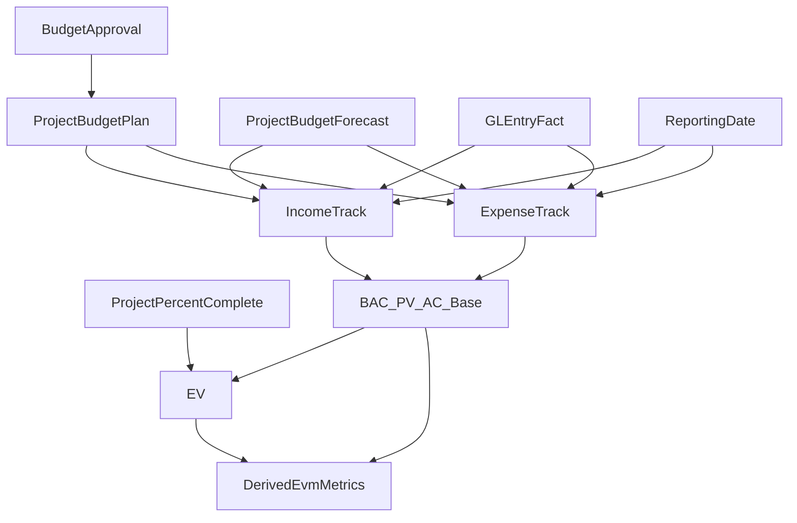

# Логика расчета EVM на данных Dinext

## Назначение документа

Этот документ описывает, как финансовые данные Dinext-проектов соотносятся с EVM-метриками и как их следует рассчитывать на базе текущей модели `plan / forecast / fact`.

Документ не реализует расчеты в коде и не меняет существующую P&L-логику Dinext. Его задача — зафиксировать методологию, по которой EVM можно считать поверх уже существующих данных проекта.

Теоретическая база и формулы EVM приведены в отдельном документе `docs/references/project-financial-metrics-evm.md`. Здесь описана именно привязка к данным Dinext.

## Источники данных Dinext

### 1. Project Budget как базовая матрица проекта

`Project Budget` хранит проектный бюджет в разрезе:

- проекта (`pb_project`);
- счета (`pb_account`);
- набора аналитических измерений (`Project Budget Dimension`);
- помесячных сумм (`Project Budget Amount`).

Это основной read model для финансов проекта.

### 2. План и прогноз

В дочернем табличном блоке `Project Budget Amount` используются поля:

- `pba_plan` — утвержденный план;
- `pba_expected` — прогноз;
- `pba_year`, `pba_month` — период.

Тем самым Dinext уже хранит time-phased бюджет проекта по месяцам.

### 3. Аналитические измерения

`Project Budget Dimension` хранит произвольные аналитические срезы в виде:

- `doc`;
- `docname`.

На практике это позволяет хранить бюджет проекта в разрезе задач, ролей, бизнес-направлений и других аналитик.

### 4. Факт

Фактические значения в Dinext берутся не из `Project Budget`, а из `GL Entry`.

В UI проекта и в отчетах факт материализуется в runtime как значения вида:

- `fact_YYYY_M` в проектной P&L-таблице;
- `actual_YYYY_MM` в отчете `Project Budget Plan vs Forecast`.

### 5. Approval flow для плана

План проходит через approval flow `Budget -> Project Budget`:

1. пользователь сохраняет план на согласование;
2. создается ERPNext `Budget`;
3. после approve данные синхронизируются в `Project Budget`;
4. в `Project Budget Amount.pba_plan` фиксируется утвержденный план.

Это важно для EVM, потому что именно approved plan должен использоваться как базовый бюджет.

## Как Dinext считает проектные финансы сейчас

На текущий момент в Dinext уже реализована надежная логика для:

- плановых помесячных значений;
- прогнозных помесячных значений;
- фактических помесячных значений;
- процентного отклонения между plan и actual/forecast;
- валовой прибыли;
- рентабельности;
- rollup-агрегации по иерархии счетов, задач и измерений.

Иными словами, Dinext уже умеет считать **P&L / budget variance**, но еще не считает EVM как отдельный слой.

### Что именно уже считается

1. **План** берется из `pba_plan`.
2. **Прогноз** берется из `pba_expected`.
3. **Факт** собирается из `GL Entry`.
4. Для прошлых периодов интерфейс показывает факт, для текущих и будущих — прогноз.
5. Итоговые расчеты проекта включают:
   - income;
   - expenses;
   - gross profit;
   - profitability.

Эта логика полезна для финансового контроля, но не дает EVM-метрики автоматически.

## Согласованные правила расчета EVM для Dinext

Ниже зафиксирована целевая методология, согласованная для Dinext.

### 1. Два независимых EVM-контура

EVM рассчитывается **отдельно**:

- по доходам;
- по расходам.

Для каждого контура формируется свой набор метрик: `BAC`, `PV`, `AC`, `EV`, `CV`, `SV`, `CPI`, `SPI`, `EAC`, `ETC`, `VAC`, `TCPI`.

Итоговая прибыль проекта при этом остается отдельным P&L-показателем и не подменяет EVM.

### 2. Уровень расчета

Расчет ведется на уровне **всего проекта**, а не на уровне task-budget.

Хотя в Dinext есть аналитика по задачам, в текущей согласованной методологии бюджет задачи не используется напрямую в формуле `EV`.

### 3. Источник прогресса проекта

Для расчета `EV` используется единый проектный прогресс:

- поле `Project.percent_complete` (стандартный ERPNext `Project`);
- один и тот же `% completion` применяется и к доходному, и к расходному контуру.

Task-level прогресс может использоваться как контрольная детализация, но не участвует в агрегировании `EV` в этой версии методики.

### 4. Отчетная дата

Все кумулятивные EVM-показатели считаются **на выбранную отчетную дату**.

Это касается:

- `PV`;
- `AC`;
- `EV`.

Отчетная дата должна быть параметром расчета, а не всегда равняться текущей дате сервера.

### 5. Учет текущего месяца

Если отчетная дата попадает внутрь месяца, кумулятивные значения считаются с **daily proration**:

- план за текущий месяц включается пропорционально дням до отчетной даты;
- факт за текущий месяц также включается пропорционально дням до отчетной даты.

Это позволяет избежать резкого скачка показателей в середине месяца.

### 6. Метод `EAC` по умолчанию

В Dinext по умолчанию используется формула:

`EAC = AC + (BAC - EV) / (CPI * SPI)`

То есть прогноз по завершении учитывает одновременно и отклонение по стоимости, и отклонение по срокам.

### 7. Статус `forecast`

`pba_expected` остается управленческим прогнозом Dinext.

Его нельзя автоматически трактовать как:

- `ETC`;
- `EAC`.

Он может использоваться как дополнительный прогнозный слой, но не как формально эквивалентный EVM-показатель без отдельной методики.

## Маппинг Dinext-данных на EVM-метрики

### Базовые метрики

| Метрика | Источник Dinext | Логика расчета |
| --- | --- | --- |
| `BAC` | `SUM(pba_plan)` по корневым счетам нужного контура | Базовый бюджет проекта по доходам или расходам за весь горизонт |
| `PV` | `SUM(pba_plan)` до отчетной даты | Кумулятивный план на дату, включая daily proration текущего месяца |
| `AC` | `GL Entry` -> факт | Кумулятивный факт на дату по соответствующему контуру |
| `EV` | `Project.percent_complete` + `BAC` | `EV = BAC_track * (Project.percent_complete / 100)` |

### Производные метрики

| Метрика | Формула | Комментарий |
| --- | --- | --- |
| `CV` | `EV - AC` | Отклонение по стоимости |
| `SV` | `EV - PV` | Отклонение по срокам / объему |
| `CPI` | `EV / AC` | Индекс выполнения стоимости |
| `SPI` | `EV / PV` | Индекс выполнения сроков |
| `EAC` | `AC + (BAC - EV) / (CPI * SPI)` | Прогноз по завершении по умолчанию |
| `ETC` | `EAC - AC` | Сколько еще нужно потратить/освоить до завершения |
| `VAC` | `BAC - EAC` | Отклонение по завершении |
| `TCPI` | `(BAC - EV) / (BAC - AC)` | Требуемая эффективность до конца проекта |

## Какие метрики можно считать уже сейчас

При наличии:

- approved plan в `pba_plan`;
- факта из `GL Entry`;
- значения `Project.percent_complete`;
- отчетной даты;

Dinext методологически уже покрывает весь набор EVM-метрик.

Наиболее надежные исходные данные в текущей модели:

1. `BAC` — хорошо обеспечен approved plan.
2. `PV` — хорошо обеспечен помесячным планом.
3. `AC` — хорошо обеспечен бухгалтерским фактом.
4. `EV` — обеспечивается только при условии, что `Project.percent_complete` действительно поддерживается как управленчески значимое поле проекта.

## Какие ограничения остаются

### 1. EVM строится поверх P&L, а не наоборот

Текущая Dinext-модель исторически ориентирована на:

- plan / forecast / fact;
- валовую прибыль;
- рентабельность.

Поэтому EVM здесь является дополнительным аналитическим слоем, а не базовой архитектурой финансов проекта.

### 2. Нет встроенного cumulative as-of слоя в текущем коде

В существующей реализации UI и отчета данные в основном живут как помесячные значения.

То есть:

- помесячные атомарные значения есть;
- стандартная EVM-логика cumulative to status date явно не реализована в коде.

В этом документе она фиксируется как целевой расчетный слой.

### 3. `Project.percent_complete` вне текущего приложения

В этом репозитории нет локальной реализации поля прогресса проекта.

Методология исходит из того, что используется стандартное ERPNext-поле `Project.percent_complete`. Если в конкретной инсталляции оно не используется или не заполняется, расчет `EV` и всех производных EVM-метрик теряет практическую ценность.

### 4. Forecast и EVM-прогноз — не одно и то же

`pba_expected` полезен как управленческий прогноз, но:

- не равен `ETC`;
- не равен `EAC`;
- не должен автоматически подменять формальные EVM-прогнозы.

### 5. Два контура усложняют интерпретацию

Так как EVM считается отдельно по доходам и отдельно по расходам:

- проект получает два набора показателей;
- итоговая валовая прибыль должна анализироваться параллельно;
- нельзя просто смешать оба контура в один коэффициент без отдельной методики.

## Рекомендуемая последовательность расчета

1. Выбрать проект и отчетную дату.
2. Разделить P&L-данные проекта на два контура:
   - `Income`;
   - `Expense`.
3. Для каждого контура посчитать `BAC` как полную сумму approved plan.
4. Для каждого контура посчитать `PV` на отчетную дату как кумулятивный plan с daily proration текущего месяца.
5. Для каждого контура посчитать `AC` на отчетную дату как кумулятивный факт из `GL Entry` с daily proration текущего месяца.
6. Взять `Project.percent_complete`.
7. Рассчитать `EV = BAC_track * (Project.percent_complete / 100)`.
8. Рассчитать `CV`, `SV`, `CPI`, `SPI`.
9. Рассчитать `EAC` по формуле `AC + (BAC - EV) / (CPI * SPI)`.
10. Рассчитать `ETC`, `VAC`, `TCPI`.
11. Показать оба EVM-набора вместе с текущими P&L-показателями Dinext.

## Поток данных

## Практический вывод

Dinext уже содержит сильную основу для EVM:

- утвержденный план;
- прогноз;
- фактические проводки;
- иерархию счетов и измерений;
- механизм согласования бюджета.

Чтобы EVM был осмысленным, в системе нужно управленчески поддерживать всего два дополнительных соглашения:

1. `Project.percent_complete` должен быть реальным источником прогресса проекта.
2. Расчет должен всегда выполняться на выбранную отчетную дату, а не только по полным календарным месяцам.

При этих условиях Dinext можно использовать как надежный источник `BAC`, `PV`, `AC`, `EV` и всех стандартных производных EVM-метрик.

## Связанные материалы

- `docs/references/project-financial-metrics-evm.md`
- `dinext_projects_pl/dinext_projects_pl/doctype/project_budget/project_budget.json`
- `dinext_projects_pl/dinext_projects_pl/doctype/project_budget_amount/project_budget_amount.json`
- `dinext_projects_pl/dinext_projects_pl/doctype/project_budget_dimension/project_budget_dimension.json`
- `dinext_projects_pl/dinext_projects_pl/budget_approval/service.py`
- `dinext_projects_pl/dinext_projects_pl/public/js/project_pl.js`
- `dinext_projects_pl/dinext_projects_pl/public/js/project_pl_calc.js`
- `dinext_projects_pl/dinext_projects_pl/report/project_budget_plan_vs_forecast/project_budget_plan_vs_forecast.py`
