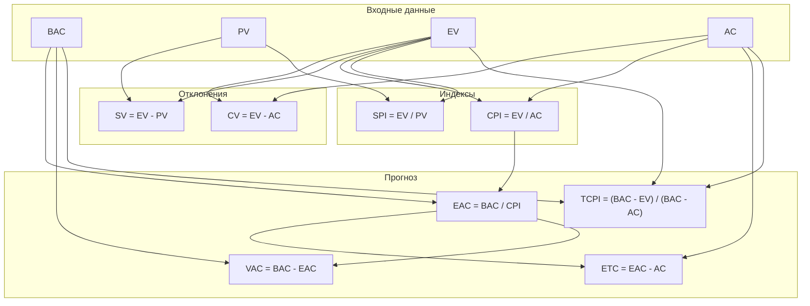

# Общий перечень финансовых метрик проектов (EVM)

## Назначение

Метод Earned Value Management (EVM) объединяет в одной системе три измерения проекта:

- объем выполненных работ;
- календарный план;
- бюджет и фактические затраты.

За счет этого EVM позволяет не только фиксировать текущее состояние проекта, но и прогнозировать его завершение по деньгам и по управленческой эффективности.

## Что должно быть зафиксировано до расчета

Перед расчетом метрик EVM в проекте должны быть согласованы:

1. базовый бюджет проекта и базовый план стоимости;
2. календарный план работ;
3. правило признания выполненной работы для расчета `EV`;
4. единая валюта проекта;
5. периодичность пересчета показателей.

Практически это важно потому, что `EV` нельзя надежно считать только по потраченному времени. Нужно заранее определить, когда работа считается выполненной: например, по бинарному правилу "сделано/не сделано", по закрытию этапа, по приемке результата или по иной согласованной схеме.

## Логика расчета

Сначала определяются базовые денежные показатели `PV`, `EV`, `AC`, `BAC`. Из них выводятся отклонения, индексы эффективности и прогнозы.

## Группа 1. Базовые абсолютные показатели

Это исходные денежные величины, на которых строится весь EVM-анализ.

| Код | Название | English | Смысл | Единица |
| --- | --- | --- | --- | --- |
| `PV` | Плановый объем | Planned Value | Стоимость работ, которые по плану должны быть выполнены к выбранной дате | Деньги |
| `EV` | Освоенный объем | Earned Value | Плановая стоимость фактически выполненных работ | Деньги |
| `AC` | Фактическая стоимость | Actual Cost | Реальные затраты на фактически выполненные работы | Деньги |
| `BAC` | Бюджет по завершению | Budget at Completion | Полный утвержденный бюджет проекта на дату завершения | Деньги |

### Уточнения по базовым показателям

- `PV` бывает текущим и кумулятивным.
- `BAC` по сути равен кумулятивному `PV` на конец проекта.
- `EV` оценивает не затраченные усилия, а стоимость реально достигнутого результата.
- `AC` показывает фактическое потребление бюджета, независимо от того, насколько полезный результат получен.

## Группа 2. Абсолютные отклонения

Эти показатели отвечают на вопрос, насколько проект отклонился от плана на текущий момент.

| Код | Название | Формула | Интерпретация |
| --- | --- | --- | --- |
| `CV` | Отклонение по стоимости | `EV - AC` | Если `< 0`, проект идет с перерасходом; если `> 0`, есть экономия |
| `SV` | Отклонение по срокам / объему | `EV - PV` | Если `< 0`, проект отстает от плана; если `> 0`, идет с опережением |

## Группа 3. Индексные фактические показатели

Эти показатели отражают относительную эффективность проекта, а не абсолютную сумму отклонения.

| Код | Название | Формула | Интерпретация |
| --- | --- | --- | --- |
| `CPI` | Индекс выполнения стоимости | `EV / AC` | Показывает, сколько запланированного результата проект получает на каждый потраченный рубль. Если `> 1`, это хорошо; если `< 1`, проект тратит деньги неэффективно |
| `SPI` | Индекс выполнения сроков | `EV / PV` | Показывает, насколько фактический прогресс соответствует плану. Если `> 1`, проект опережает план; если `< 1`, отстает |

## Группа 4. Абсолютные прогнозные показатели

Эти метрики переносят текущую динамику проекта на прогноз завершения.

| Код | Название | Формула | Интерпретация |
| --- | --- | --- | --- |
| `EAC` | Прогноз по завершении | `BAC / CPI` | Прогноз итоговой стоимости проекта, если текущая эффективность сохранится |
| `ETC` | Прогноз до завершения | `EAC - AC` | Сколько средств еще потребуется вложить до завершения проекта |
| `VAC` | Отклонение по завершении | `BAC - EAC` | Насколько итоговый бюджет будет выше или ниже базового. Если `< 0`, проект завершится с перерасходом |

## Группа 5. Индексный прогнозный показатель

Этот показатель отвечает на вопрос, с какой эффективностью нужно работать дальше, чтобы уложиться в бюджет.

| Код | Название | Формула | Интерпретация |
| --- | --- | --- | --- |
| `TCPI` | Индекс производительности до завершения | `(BAC - EV) / (BAC - AC)` | Требуемая эффективность на оставшийся объем работ. Если `> 1`, проекту нужно работать эффективнее, чем сейчас |

## Варианты расчета `EAC`

`EAC` не всегда считается по одной и той же формуле. Выбор зависит от управленческого предположения о будущем проекта.

| Формула | Когда применять | Смысл |
| --- | --- | --- |
| `EAC = AC + ETC` | Когда оставшиеся работы переоценены вручную снизу-вверх | Текущие фактические затраты плюс новая оценка остатка |
| `EAC = BAC / CPI` | Когда предполагается, что текущая эффективность по затратам сохранится до конца | Классический прогноз по текущему `CPI` |
| `EAC = AC + (BAC - EV)` | Когда прошлые отклонения считаются разовыми, а оставшаяся работа будет выполнена по исходному бюджету | Факт на сегодня плюс оставшийся бюджет без поправки на индексы |
| `EAC = AC + (BAC - EV) / (CPI * SPI)` | Когда ожидается, что текущие отклонения по деньгам и срокам сохранятся и дальше | Остаток бюджета корректируется сразу на обе проблемы: стоимость и сроки |

## Числовой пример

Ниже приведен единый пример по данным из сквозного кейса:

- `BAC = 50 000 000`
- `PV = 7 000 000`
- `EV = 6 750 000`
- `AC = 7 100 000`

### Расчет производных метрик

| Код | Расчет | Результат | Что означает |
| --- | --- | --- | --- |
| `CV` | `6 750 000 - 7 100 000` | `-350 000` | Проект потратил на 350 тыс. больше, чем стоил выполненный результат |
| `SV` | `6 750 000 - 7 000 000` | `-250 000` | Проект недовыполнил работ на 250 тыс. относительно плана |
| `CPI` | `6 750 000 / 7 100 000` | `0.951` | На каждый рубль затрат проект получает только 95.1% от планового результата |
| `SPI` | `6 750 000 / 7 000 000` | `0.964` | Проект движется примерно на 96.4% от планового темпа |
| `EAC` | `50 000 000 / 0.951` | `52 576 235.54` | Если ничего не менять, итоговая стоимость превысит базовый бюджет |
| `ETC` | `52 576 235.54 - 7 100 000` | `45 476 235.54` | Столько еще потребуется вложить при текущей динамике |
| `VAC` | `50 000 000 - 52 576 235.54` | `-2 576 235.54` | Ожидаемый перерасход к завершению проекта |
| `TCPI` | `(50 000 000 - 6 750 000) / (50 000 000 - 7 100 000)` | `1.0081` | Чтобы остаться в `BAC`, нужно работать примерно на 0.8% эффективнее на оставшемся объеме |

## Сводная таблица всех метрик

| Код | Тип | Формула | Единица | Хорошее значение | Основной управленческий вопрос |
| --- | --- | --- | --- | --- | --- |
| `PV` | Базовая | задается планом | Деньги | n/a | Что должно быть выполнено к дате? |
| `EV` | Базовая | определяется фактом выполнения | Деньги | Чем больше, тем лучше относительно `PV` | Сколько полезного результата реально получено? |
| `AC` | Базовая | определяется фактическими затратами | Деньги | Чем меньше относительно `EV`, тем лучше | Сколько реально потрачено? |
| `BAC` | Базовая | задается бюджетом | Деньги | n/a | Каков утвержденный бюджет проекта? |
| `CV` | Отклонение | `EV - AC` | Деньги | `> 0` | Есть ли перерасход сейчас? |
| `SV` | Отклонение | `EV - PV` | Деньги | `> 0` | Идем ли мы впереди или позади плана? |
| `CPI` | Индекс | `EV / AC` | Коэффициент | `> 1` | Насколько эффективно расходуются деньги? |
| `SPI` | Индекс | `EV / PV` | Коэффициент | `> 1` | Насколько эффективно соблюдается график? |
| `EAC` | Прогноз | `BAC / CPI` или альтернативы | Деньги | Чем ближе к `BAC`, тем лучше | Во сколько проект обойдется по завершении? |
| `ETC` | Прогноз | `EAC - AC` | Деньги | Чем меньше при сопоставимом scope, тем лучше | Сколько еще придется потратить? |
| `VAC` | Прогноз | `BAC - EAC` | Деньги | `> 0` | На какую сумму проект отклонится от бюджета в конце? |
| `TCPI` | Прогнозный индекс | `(BAC - EV) / (BAC - AC)` | Коэффициент | `<= 1` | Какой эффективности нужно добиться дальше, чтобы уложиться в бюджет? |

## Практические правила интерпретации

1. Небольшой отрицательный `CV` на ранней стадии проекта может привести к крупному отрицательному `VAC` к завершению, если не менять модель исполнения.
2. `TCPI` полезно анализировать вместе с `CV` и `VAC`, иначе он может создавать ложное впечатление управляемости ситуации.
3. `EAC` и `ETC` допустимо не только рассчитывать, но и задавать по результатам управленческого перепланирования.
4. Если проект работает по Time and Material, правила признания `EV` нужно оговаривать отдельно, иначе показатель теряет смысл.
5. EVM лучше использовать как регулярный светофор проекта: пересчитывать метрики на единую отчетную дату и отслеживать их тренд, а не только единичное значение.

## Рекомендуемый порядок расчета в проекте

1. Зафиксировать `BAC`, календарный план и правило расчета `EV`.
2. На отчетную дату определить `PV`, `EV`, `AC`.
3. Рассчитать текущие отклонения: `CV`, `SV`.
4. Рассчитать текущие индексы: `CPI`, `SPI`.
5. Выбрать подход к расчету `EAC`.
6. Рассчитать `EAC`, `ETC`, `VAC`.
7. Рассчитать `TCPI`.
8. Принять управленческое решение: перепланирование, сокращение scope, усиление команды, пересмотр бюджета, изменение сроков.

## Источники

- [Финансы как универсальное мерило для управления проектом](https://rarus.ru/publications/280108/)
- [Управление освоенным бюджетом - формулы](https://about1cerp.blogspot.com/2019/04/blog-post_75.html)
